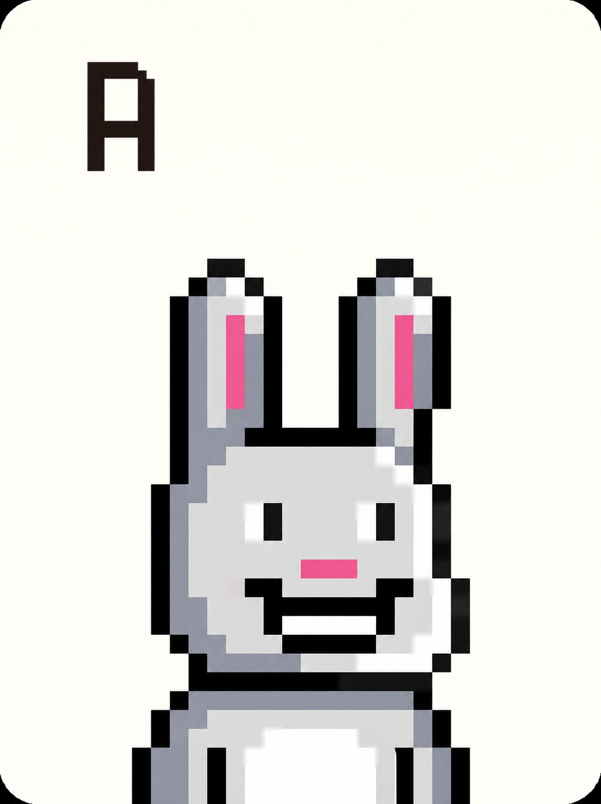
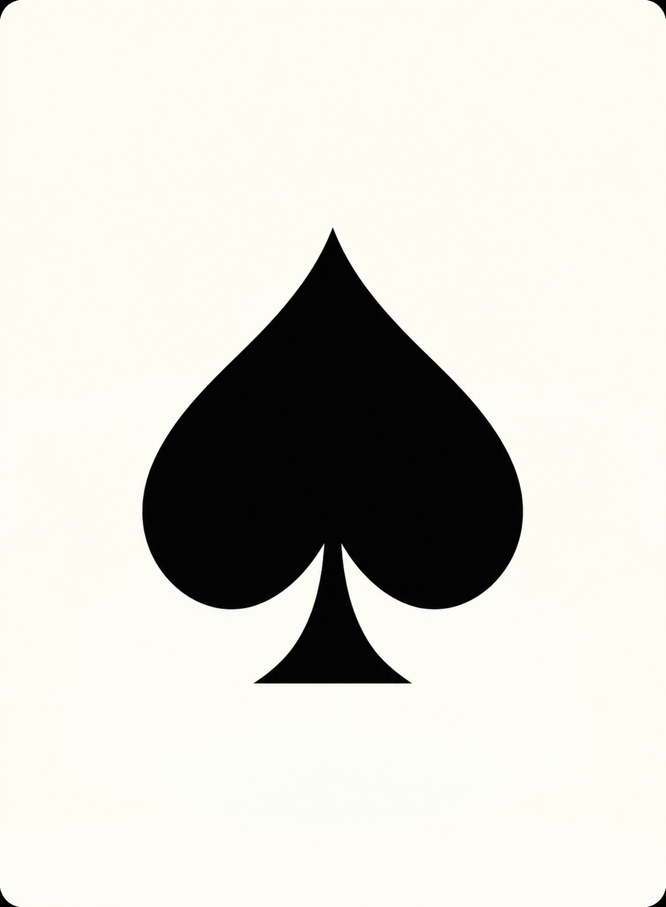
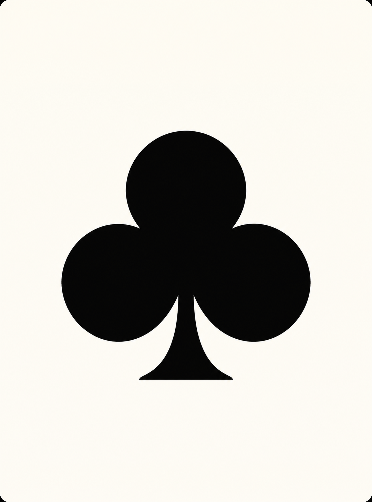

# 普通牌

[返回總覽](../README.md)

## ART-004 · J 角色牌

狀態：獨立設計候選稿。尺寸：1085 × 1450。

[獨立檔案](../cards/normal/J.png)

獨立不透明牌面；正式比例與對齊需驗收；生成原生畫布未強制重採樣，正式625×835及前景疊圖對齊未驗收

## ART-005 · Q 角色牌

狀態：獨立設計候選稿。尺寸：1085 × 1450。

[獨立檔案](../cards/normal/Q.png)

角色忠實方向；生成檔像素與625:835精準座標仍需核對；生成原生畫布未強制重採樣，正式625×835及前景疊圖對齊未驗收

## ART-006 · K 角色牌

狀態：獨立設計候選稿。尺寸：1085 × 1450。

[獨立檔案](../cards/normal/K.png)

角色忠實方向；生成檔像素與625:835精準座標仍需核對；生成原生畫布未強制重採樣，正式625×835及前景疊圖對齊未驗收

## ART-007 · A 角色牌

狀態：獨立設計候選稿。尺寸：1085 × 1450。

[獨立檔案](../cards/normal/A.png)

角色忠實方向；生成檔像素與625:835精準座標仍需核對；生成原生畫布未強制重採樣，正式625×835及前景疊圖對齊未驗收

## ART-008 · 黑桃 獨立花色牌

狀態：獨立設計候選稿。尺寸：1075 × 1463。

[獨立檔案](../cards/normal/S.png)

獨立不透明牌面；正式比例與對齊需驗收；生成原生畫布未強制重採樣，正式625×835及前景疊圖對齊未驗收

## ART-009 · 紅心 獨立花色牌

狀態：獨立設計候選稿。尺寸：1076 × 1461。

[獨立檔案](../cards/normal/H.png)

獨立不透明牌面；正式比例與對齊需驗收；生成原生畫布未強制重採樣，正式625×835及前景疊圖對齊未驗收

## ART-010 · 梅花 獨立花色牌

狀態：獨立設計候選稿。尺寸：1080 × 1457。

[獨立檔案](../cards/normal/C.png)

獨立不透明牌面；正式比例與對齊需驗收；生成原生畫布未強制重採樣，正式625×835及前景疊圖對齊未驗收

## ART-011 · 方塊 獨立花色牌

狀態：獨立設計候選稿。尺寸：1050 × 1498。

[獨立檔案](../cards/normal/D.png)

獨立不透明牌面；正式比例與對齊需驗收；生成原生畫布未強制重採樣，正式625×835及前景疊圖對齊未驗收
