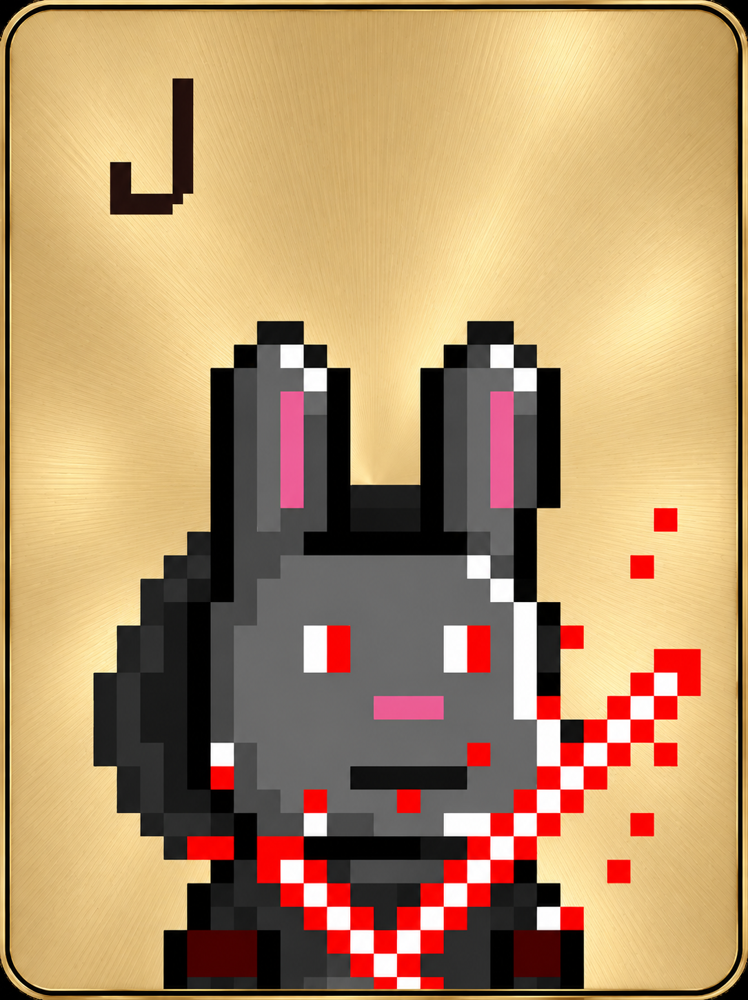
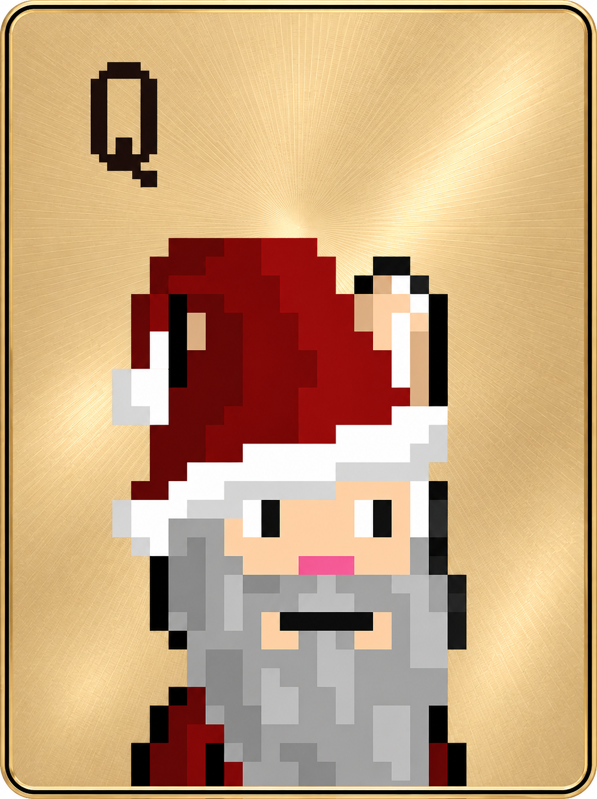
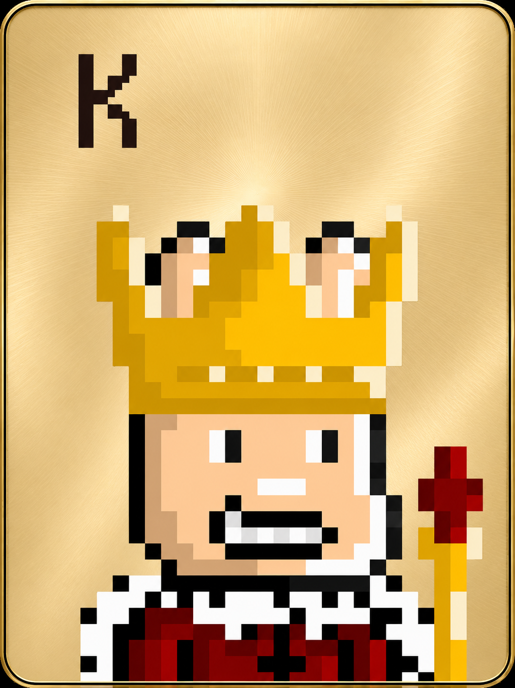
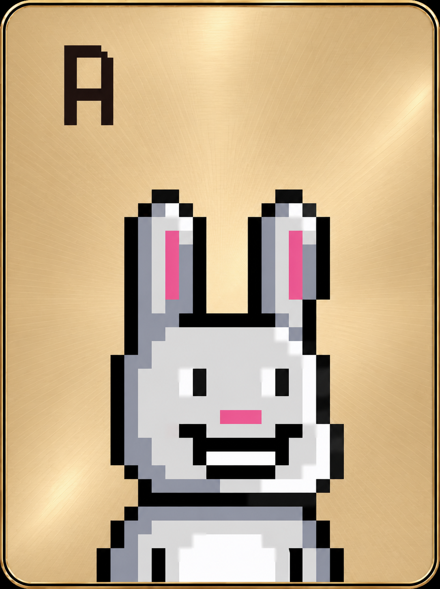
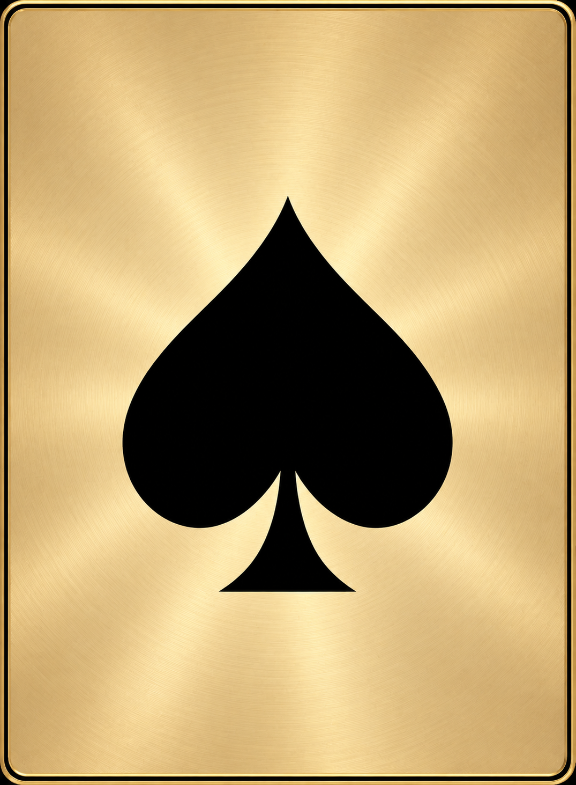
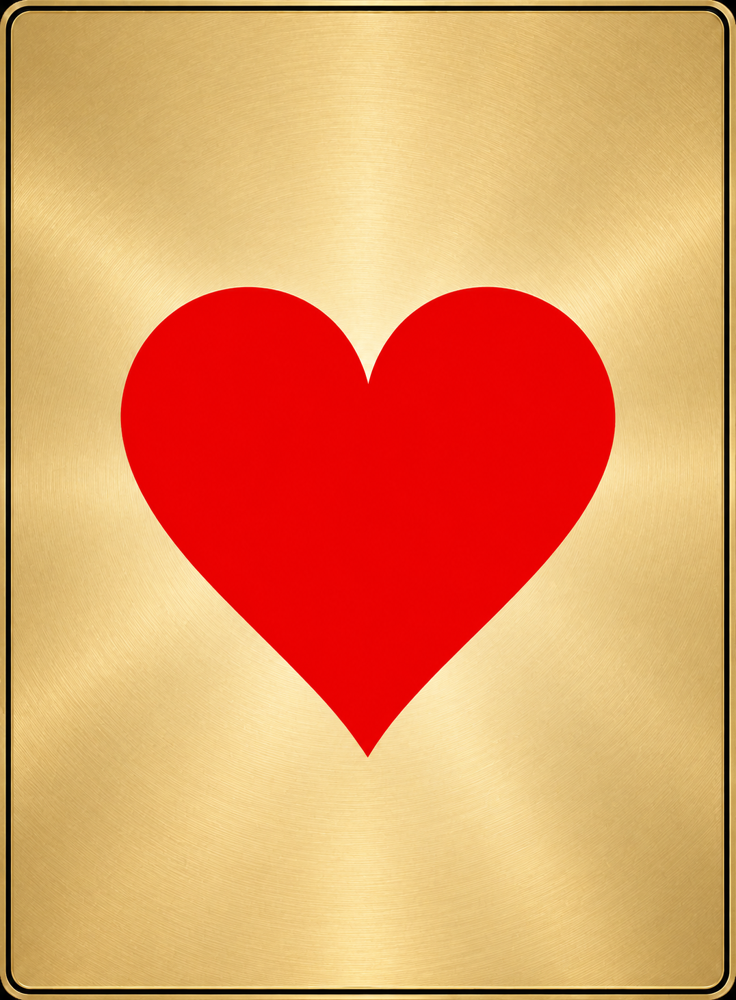
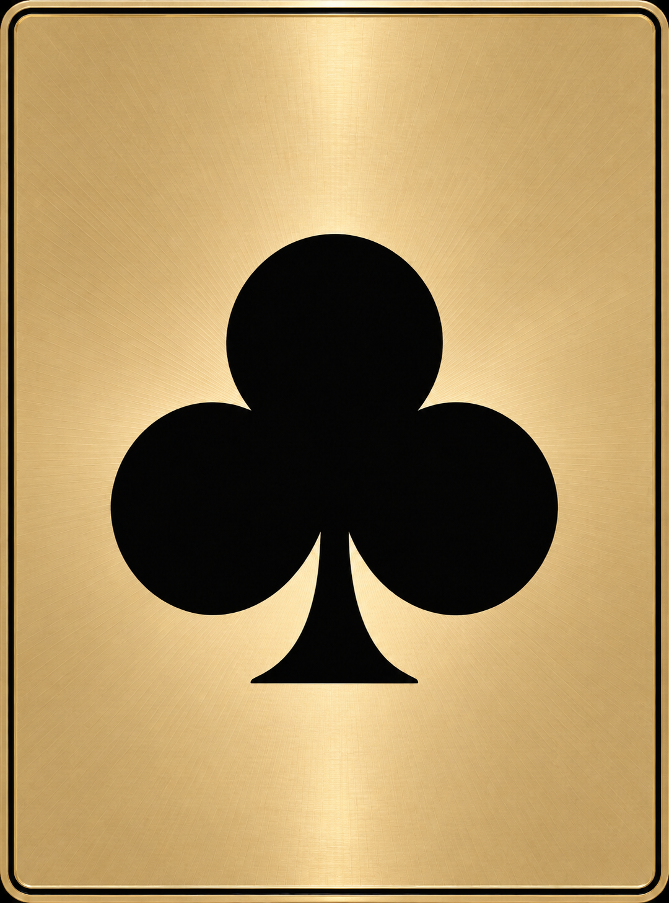
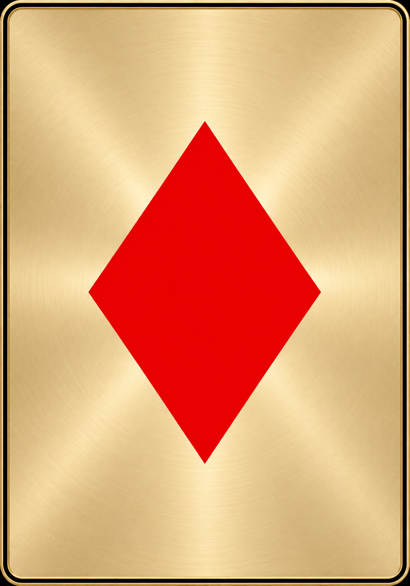

# 金牌

[返回總覽](../README.md)

## ART-012 · J 金牌

狀態：獨立設計候選稿。尺寸：1085 × 1450。

[獨立檔案](../cards/gold/J.png)

獨立生成候選；與普通牌精準疊圖及共同畫布尚未正式驗收；生成原生畫布未強制重採樣，正式625×835及前景疊圖對齊未驗收

## ART-013 · Q 金牌

狀態：獨立設計候選稿。尺寸：1085 × 1450。

[獨立檔案](../cards/gold/Q.png)

獨立生成候選；與普通牌精準疊圖及共同畫布尚未正式驗收；生成原生畫布未強制重採樣，正式625×835及前景疊圖對齊未驗收

## ART-014 · K 金牌

狀態：獨立設計候選稿。尺寸：1085 × 1450。

[獨立檔案](../cards/gold/K.png)

獨立生成候選；與普通牌精準疊圖及共同畫布尚未正式驗收；生成原生畫布未強制重採樣，正式625×835及前景疊圖對齊未驗收

## ART-015 · A 金牌

狀態：獨立設計候選稿。尺寸：1085 × 1450。

[獨立檔案](../cards/gold/A.png)

獨立生成候選；與普通牌精準疊圖及共同畫布尚未正式驗收；生成原生畫布未強制重採樣，正式625×835及前景疊圖對齊未驗收

## ART-016 · S 金牌

狀態：獨立設計候選稿。尺寸：1075 × 1463。

[獨立檔案](../cards/gold/S.png)

獨立生成候選；與普通牌精準疊圖及共同畫布尚未正式驗收；生成原生畫布未強制重採樣，正式625×835及前景疊圖對齊未驗收

## ART-017 · H 金牌

狀態：獨立設計候選稿。尺寸：1076 × 1461。

[獨立檔案](../cards/gold/H.png)

獨立生成候選；與普通牌精準疊圖及共同畫布尚未正式驗收；生成原生畫布未強制重採樣，正式625×835及前景疊圖對齊未驗收

## ART-018 · C 金牌

狀態：獨立設計候選稿。尺寸：1080 × 1456。

[獨立檔案](../cards/gold/C.png)

獨立生成候選；與普通牌精準疊圖及共同畫布尚未正式驗收；生成原生畫布未強制重採樣，正式625×835及前景疊圖對齊未驗收

## ART-019 · D 金牌

狀態：獨立設計候選稿。尺寸：1050 × 1498。

[獨立檔案](../cards/gold/D.png)

獨立生成候選；與普通牌精準疊圖及共同畫布尚未正式驗收；生成原生畫布未強制重採樣，正式625×835及前景疊圖對齊未驗收
