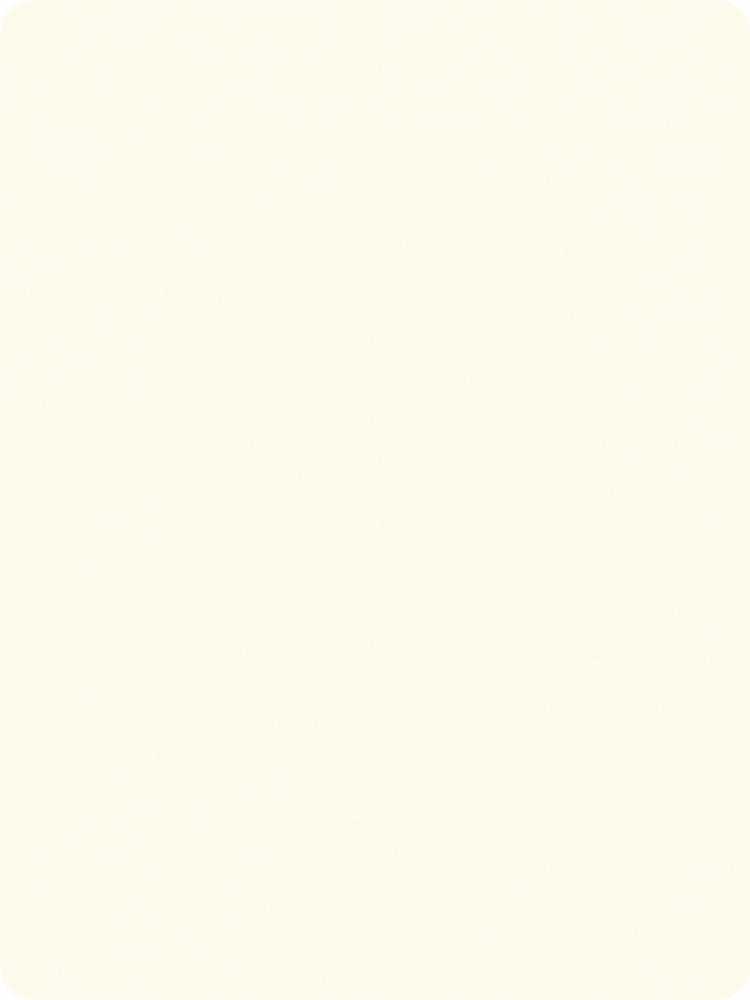
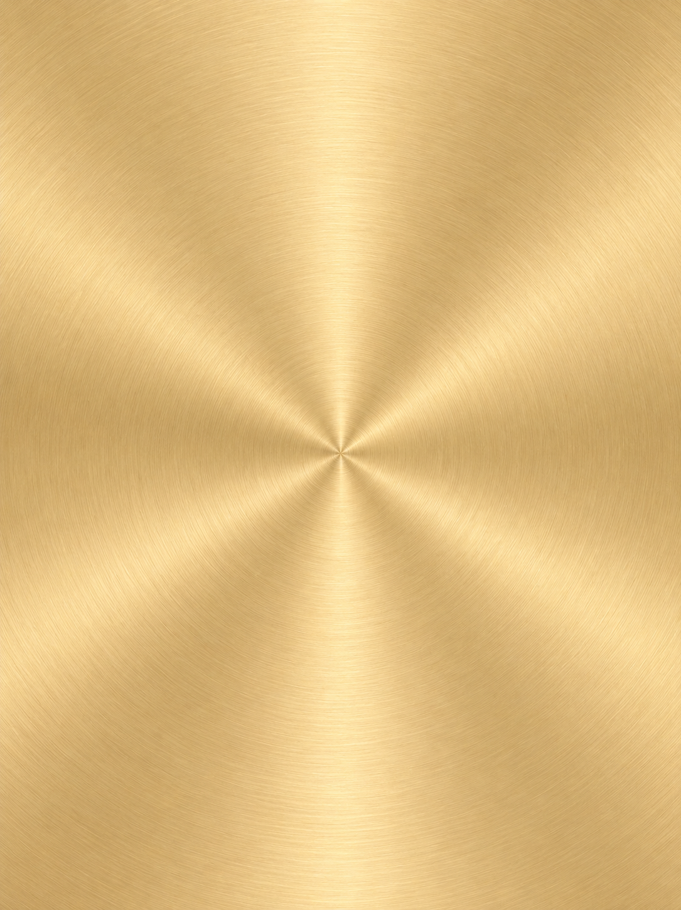
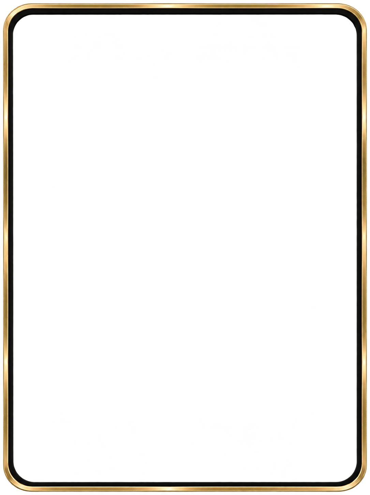
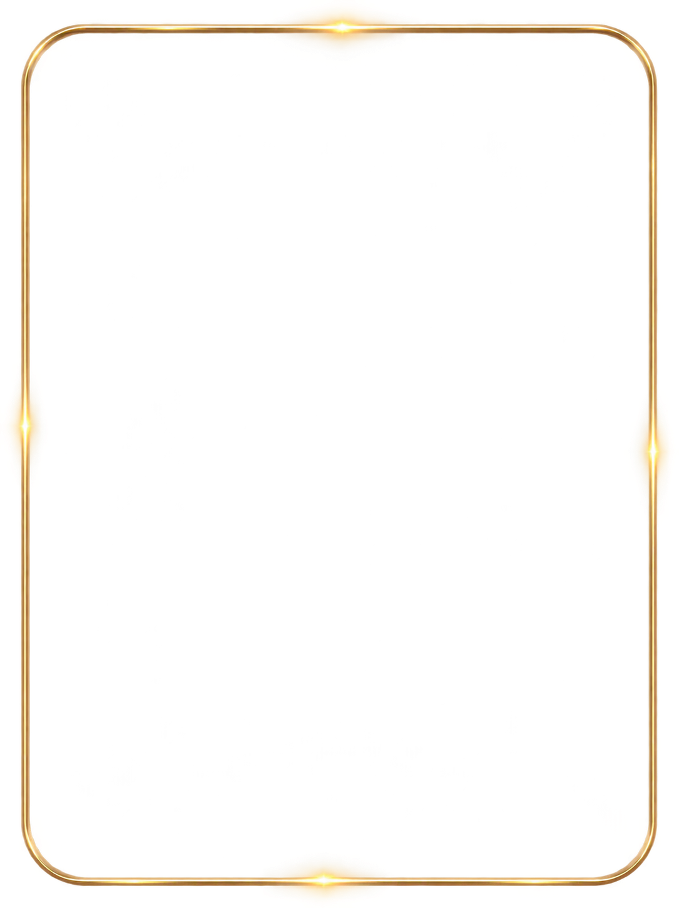
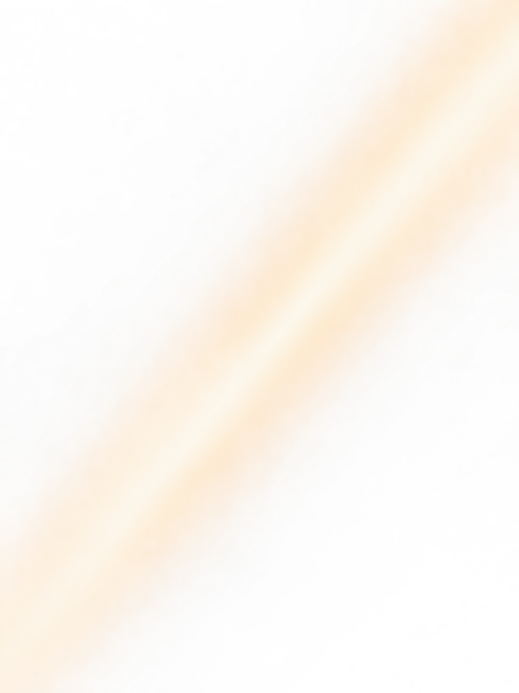
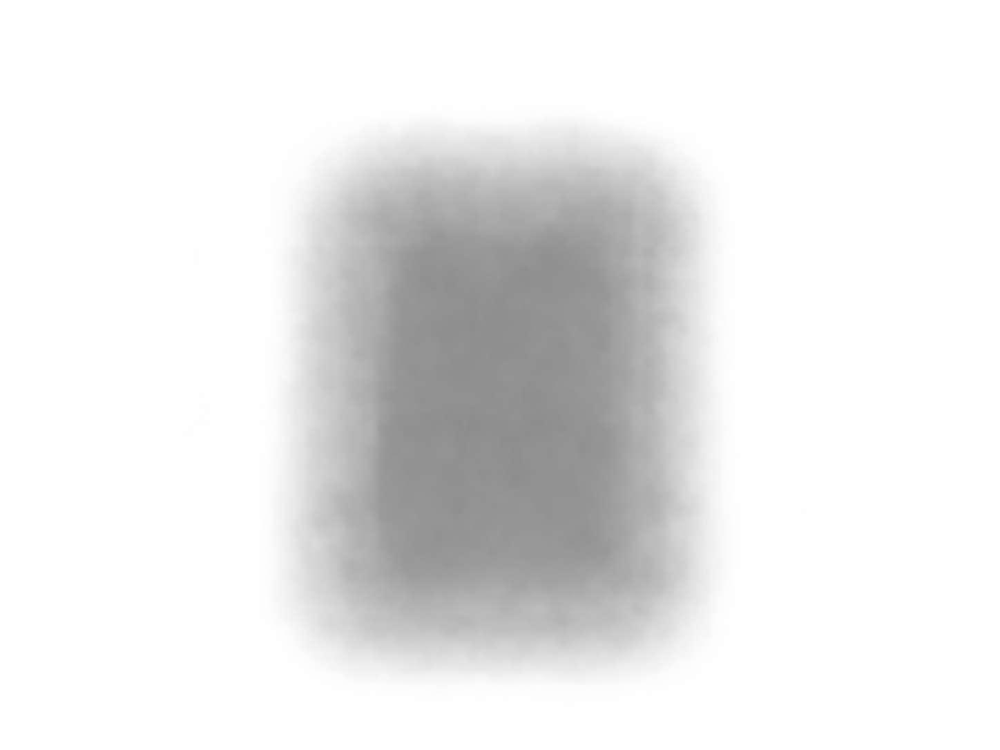
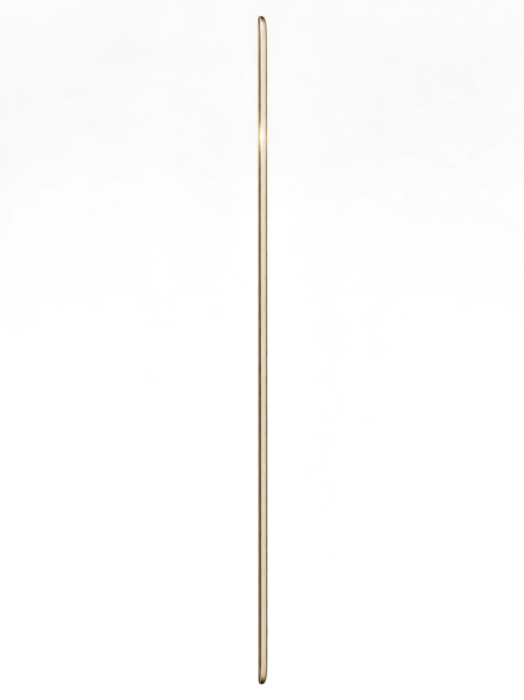

# 牌面共用層

[返回總覽](../README.md)

## ART-020 · 普通牌底

狀態：獨立設計候選稿。尺寸：1086 × 1448。

[獨立檔案](../cards/layers/normal-base.png)

已自檢修正；獨立底層／陰影，不含非要求框體；仍需對齊驗收

## ART-021 · 金牌底

狀態：獨立設計候選稿。尺寸：1085 × 1450。

[獨立檔案](../cards/layers/gold-base.png)

獨立生成候選；與普通牌精準疊圖及共同畫布尚未正式驗收

## ART-022 · 金牌黑金疊框

狀態：獨立設計候選稿。尺寸：1085 × 1450。

[獨立檔案](../cards/layers/gold-overlay.png)

獨立生成候選；與普通牌精準疊圖及共同畫布尚未正式驗收

## ART-023 · 普通牌中獎光

狀態：獨立設計候選稿。尺寸：1085 × 1450。

[獨立檔案](../cards/layers/normal-win-glow.png)

獨立生成候選；與普通牌精準疊圖及共同畫布尚未正式驗收

## ART-024 · 金牌掃光遮罩

狀態：獨立設計候選稿。尺寸：1085 × 1450。

[獨立檔案](../cards/layers/gold-sweep-mask.png)

獨立生成候選；與普通牌精準疊圖及共同畫布尚未正式驗收

## ART-025 · 卡牌背面陰影

狀態：獨立設計候選稿。尺寸：1448 × 1086。

[獨立檔案](../cards/layers/card-shadow.png)

已自檢修正；獨立底層／陰影，不含非要求框體；仍需對齊驗收

## ART-026 · 翻牌厚度側面

狀態：獨立設計候選稿。尺寸：1086 × 1449。

[獨立檔案](../cards/layers/card-edge.png)

獨立生成候選；與普通牌精準疊圖及共同畫布尚未正式驗收
