# WILD分層

[返回總覽](../README.md)

## ART-028 · 天使小WILD／金色底牌

狀態：獨立設計候選稿。尺寸：1085 × 1449。

[獨立檔案](../wild/angel/layers/01.png)

Raw transparent standalone component; generated canvas differs from625x835 and requires production alignment. Alpha predominantly252–253 on solid forms, not literal255; some raw generator edge fringes remain and need production cleanup. No exact parent-coordinate registration claimed.

## ART-029 · 天使小WILD／黑金內框

狀態：獨立設計候選稿。尺寸：1086 × 1449。

[獨立檔案](../wild/angel/layers/02.png)

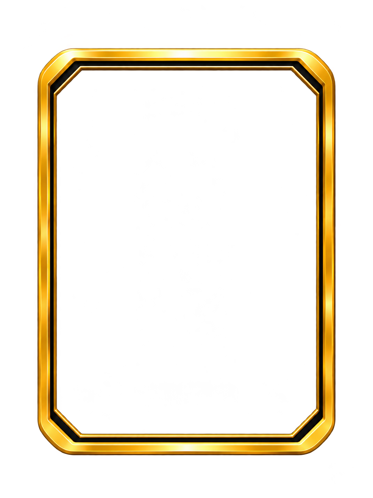

Raw transparent standalone component; generated canvas differs from625x835 and requires production alignment. Alpha predominantly252–253 on solid forms, not literal255; some raw generator edge fringes remain and need production cleanup. No exact parent-coordinate registration claimed.

## ART-030 · 天使小WILD／軀幹

狀態：獨立設計候選稿。尺寸：1536 × 1024。

[獨立檔案](../wild/angel/layers/03.png)

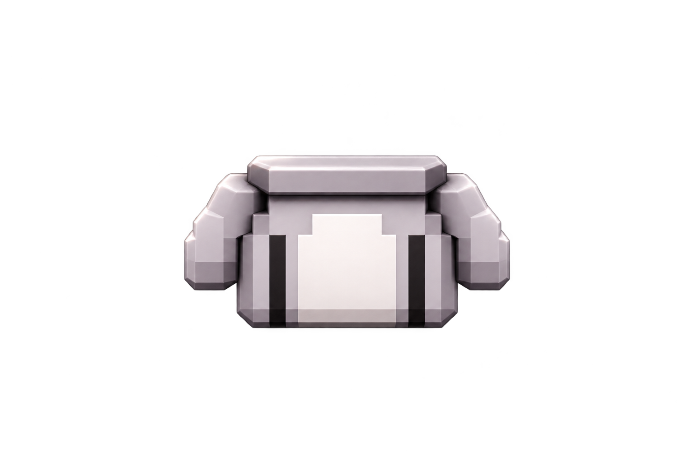

Raw transparent standalone component; generated canvas differs from625x835 and requires production alignment. Alpha predominantly252–253 on solid forms, not literal255; some raw generator edge fringes remain and need production cleanup. No exact parent-coordinate registration claimed.

## ART-031 · 天使小WILD／頭部

狀態：獨立設計候選稿。尺寸：1536 × 1024。

[獨立檔案](../wild/angel/layers/04.png)

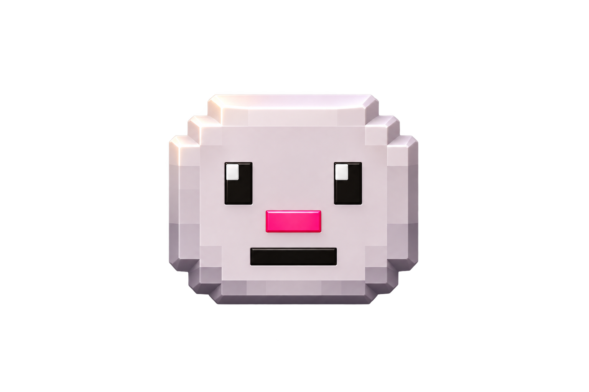

Raw transparent standalone component; generated canvas differs from625x835 and requires production alignment. Alpha predominantly252–253 on solid forms, not literal255; some raw generator edge fringes remain and need production cleanup. No exact parent-coordinate registration claimed.

## ART-032 · 天使小WILD／左耳

狀態：獨立設計候選稿。尺寸：1536 × 1024。

[獨立檔案](../wild/angel/layers/05.png)

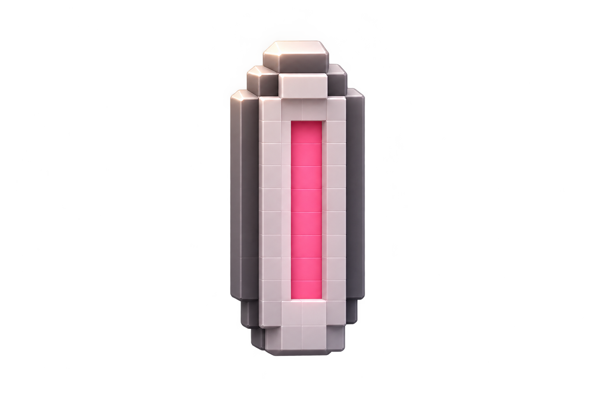

Raw transparent standalone component; generated canvas differs from625x835 and requires production alignment. Alpha predominantly252–253 on solid forms, not literal255; some raw generator edge fringes remain and need production cleanup. No exact parent-coordinate registration claimed.

## ART-033 · 天使小WILD／右耳

狀態：獨立設計候選稿。尺寸：1085 × 1450。

[獨立檔案](../wild/angel/layers/06.png)

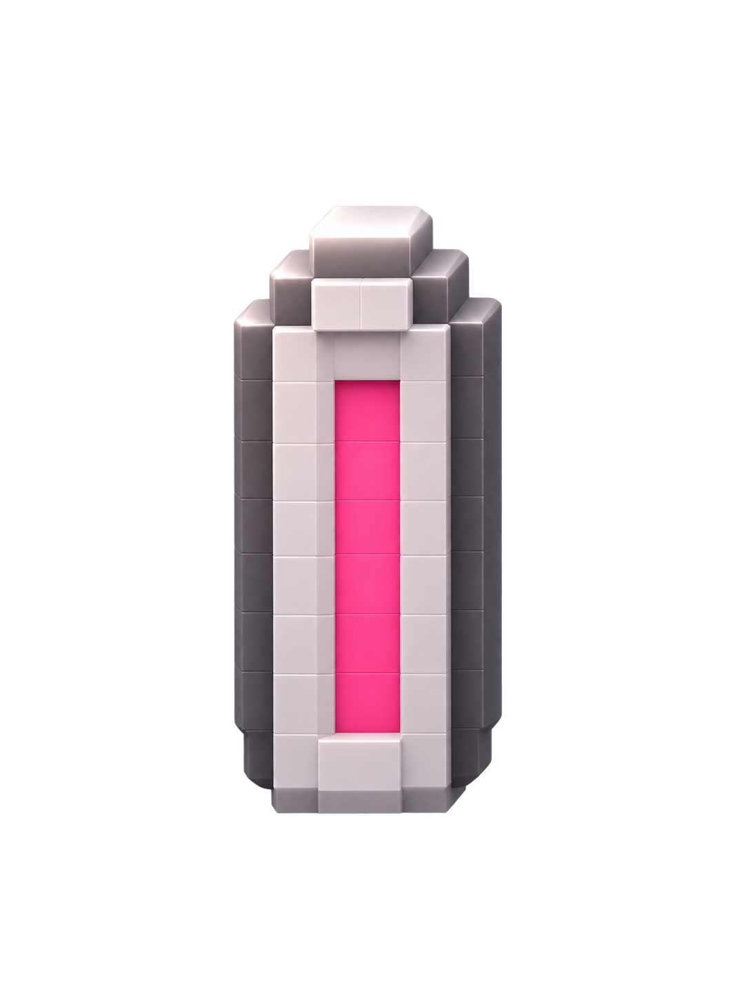

Raw transparent standalone component; generated canvas differs from625x835 and requires production alignment. Alpha predominantly252–253 on solid forms, not literal255; some raw generator edge fringes remain and need production cleanup. No exact parent-coordinate registration claimed.

## ART-034 · 天使小WILD／左翼

狀態：獨立設計候選稿。尺寸：1086 × 1449。

[獨立檔案](../wild/angel/layers/07.png)

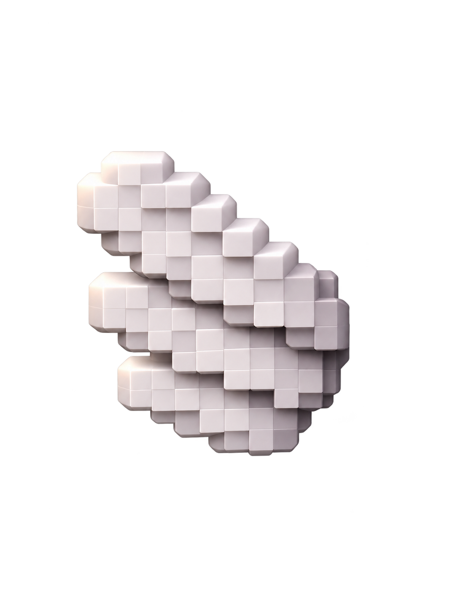

Raw transparent standalone component; generated canvas differs from625x835 and requires production alignment. Alpha predominantly252–253 on solid forms, not literal255; some raw generator edge fringes remain and need production cleanup. No exact parent-coordinate registration claimed.

## ART-035 · 天使小WILD／右翼

狀態：獨立設計候選稿。尺寸：1085 × 1450。

[獨立檔案](../wild/angel/layers/08.png)

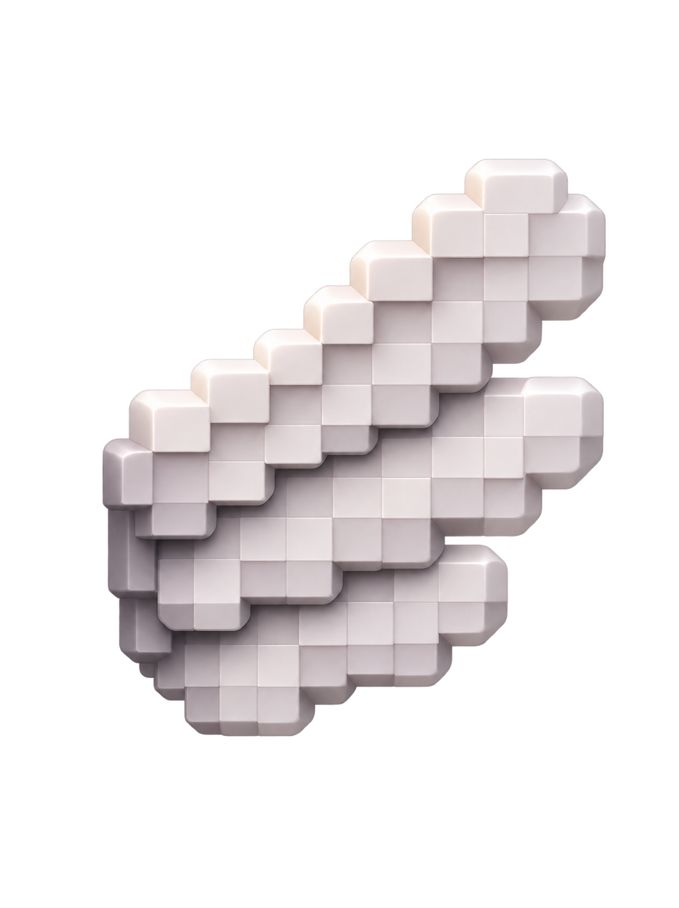

Raw transparent standalone component; generated canvas differs from625x835 and requires production alignment. Alpha predominantly252–253 on solid forms, not literal255; some raw generator edge fringes remain and need production cleanup. No exact parent-coordinate registration claimed.

## ART-036 · 天使小WILD／WILD底框

狀態：獨立設計候選稿。尺寸：1774 × 887。

[獨立檔案](../wild/angel/layers/09.png)

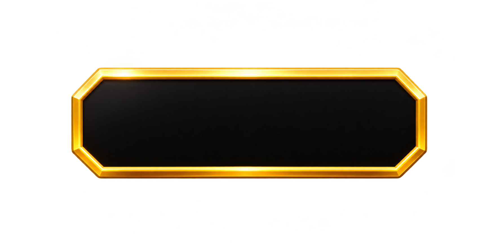

Raw transparent standalone component; generated canvas differs from625x835 and requires production alignment. Alpha predominantly252–253 on solid forms, not literal255; some raw generator edge fringes remain and need production cleanup. No exact parent-coordinate registration claimed.

## ART-037 · 天使小WILD／WILD金字

狀態：獨立設計候選稿。尺寸：1774 × 887。

[獨立檔案](../wild/angel/layers/10.png)

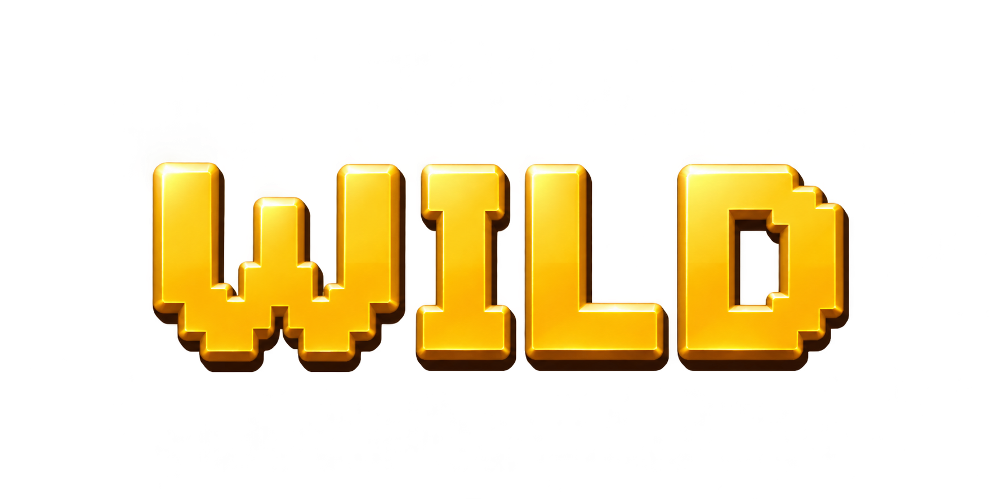

Raw transparent standalone component; generated canvas differs from625x835 and requires production alignment. Alpha predominantly252–253 on solid forms, not literal255; some raw generator edge fringes remain and need production cleanup. No exact parent-coordinate registration claimed.

## ART-038 · 天使小WILD／光環

狀態：獨立設計候選稿。尺寸：1085 × 1449。

[獨立檔案](../wild/angel/layers/11.png)

Raw transparent standalone component; generated canvas differs from625x835 and requires production alignment. Gold base/frame/lettering intentionally shared between WILD variants. Alpha predominantly252–253 on solid forms, not literal255; some raw generator edge fringes remain and need production cleanup. No exact parent-coordinate registration claimed.

## ART-040 · 惡魔大WILD／金色底牌

狀態：獨立設計候選稿。尺寸：1085 × 1449。

[獨立檔案](../wild/devil/layers/01.png)

Raw transparent standalone component; generated canvas differs from625x835 and requires production alignment. Gold base/frame/lettering intentionally shared between WILD variants. Alpha predominantly252–253 on solid forms, not literal255; some raw generator edge fringes remain and need production cleanup. No exact parent-coordinate registration claimed.

## ART-041 · 惡魔大WILD／黑金內框

狀態：獨立設計候選稿。尺寸：1086 × 1449。

[獨立檔案](../wild/devil/layers/02.png)

Raw transparent standalone component; generated canvas differs from625x835 and requires production alignment. Gold base/frame/lettering intentionally shared between WILD variants. Alpha predominantly252–253 on solid forms, not literal255; some raw generator edge fringes remain and need production cleanup. No exact parent-coordinate registration claimed.

## ART-042 · 惡魔大WILD／軀幹

狀態：獨立設計候選稿。尺寸：1085 × 1449。

[獨立檔案](../wild/devil/layers/03.png)

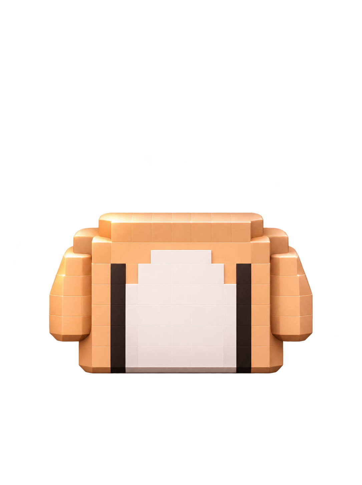

Raw transparent standalone component; generated canvas differs from625x835 and requires production alignment. Gold base/frame/lettering intentionally shared between WILD variants. Alpha predominantly252–253 on solid forms, not literal255; some raw generator edge fringes remain and need production cleanup. No exact parent-coordinate registration claimed.

## ART-043 · 惡魔大WILD／頭部

狀態：獨立設計候選稿。尺寸：1086 × 1448。

[獨立檔案](../wild/devil/layers/04.png)

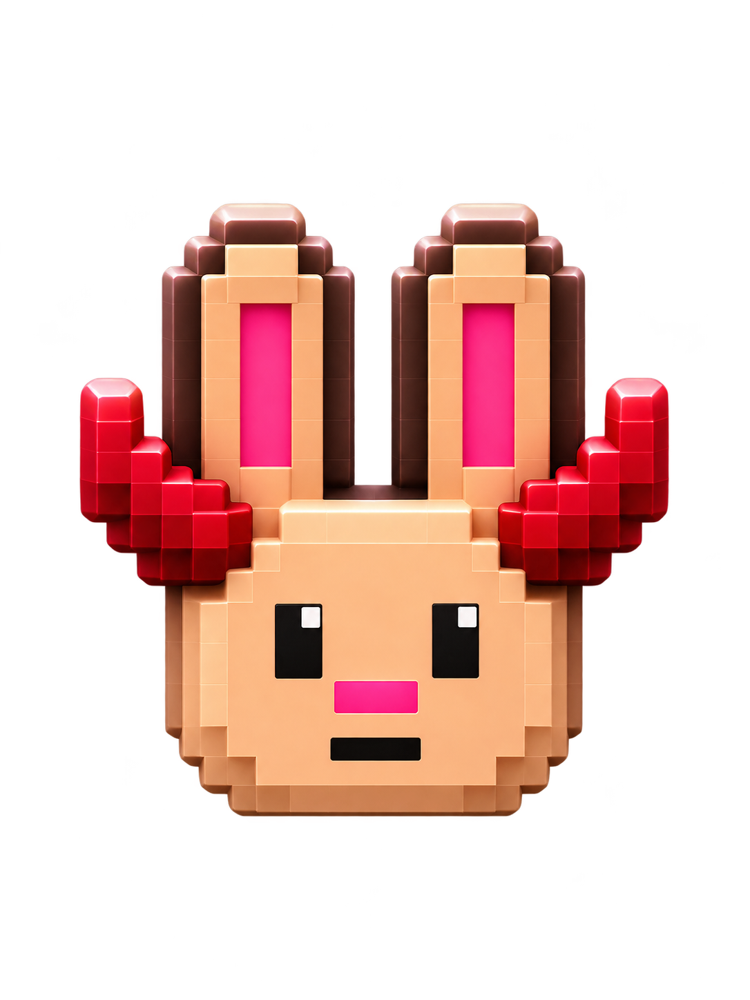

Raw transparent standalone component; generated canvas differs from625x835 and requires production alignment. Gold base/frame/lettering intentionally shared between WILD variants. Alpha predominantly252–253 on solid forms, not literal255; some raw generator edge fringes remain and need production cleanup. No exact parent-coordinate registration claimed.

## ART-044 · 惡魔大WILD／左耳

狀態：獨立設計候選稿。尺寸：1086 × 1448。

[獨立檔案](../wild/devil/layers/05.png)

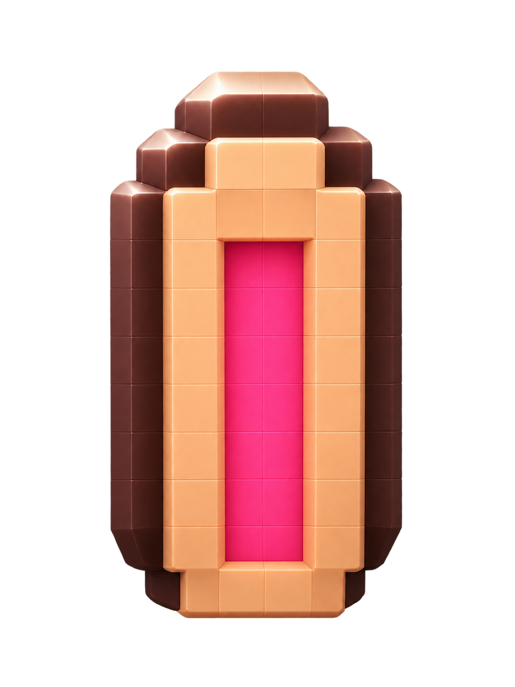

Raw transparent standalone component; generated canvas differs from625x835 and requires production alignment. Gold base/frame/lettering intentionally shared between WILD variants. Alpha predominantly252–253 on solid forms, not literal255; some raw generator edge fringes remain and need production cleanup. No exact parent-coordinate registration claimed.

## ART-045 · 惡魔大WILD／右耳

狀態：獨立設計候選稿。尺寸：1085 × 1449。

[獨立檔案](../wild/devil/layers/06.png)

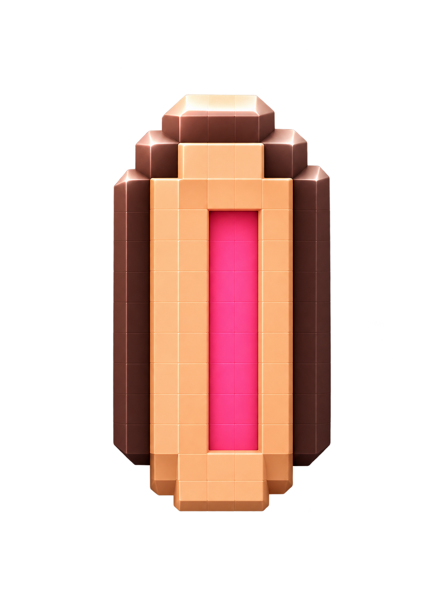

Raw transparent standalone component; generated canvas differs from625x835 and requires production alignment. Gold base/frame/lettering intentionally shared between WILD variants. Alpha predominantly252–253 on solid forms, not literal255; some raw generator edge fringes remain and need production cleanup. No exact parent-coordinate registration claimed.

## ART-046 · 惡魔大WILD／左翼

狀態：獨立設計候選稿。尺寸：1086 × 1448。

[獨立檔案](../wild/devil/layers/07.png)

Raw transparent standalone component; generated canvas differs from625x835 and requires production alignment. Gold base/frame/lettering intentionally shared between WILD variants. Alpha predominantly252–253 on solid forms, not literal255; some raw generator edge fringes remain and need production cleanup. No exact parent-coordinate registration claimed.

## ART-047 · 惡魔大WILD／右翼

狀態：獨立設計候選稿。尺寸：1086 × 1448。

[獨立檔案](../wild/devil/layers/08.png)

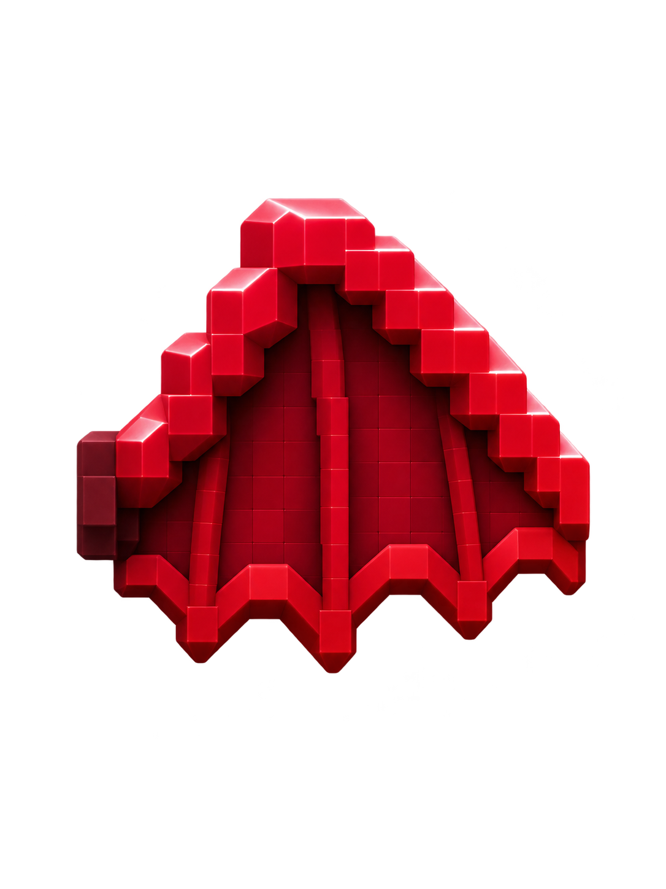

Raw transparent standalone component; generated canvas differs from625x835 and requires production alignment. Gold base/frame/lettering intentionally shared between WILD variants. Alpha predominantly252–253 on solid forms, not literal255; some raw generator edge fringes remain and need production cleanup. No exact parent-coordinate registration claimed.

## ART-048 · 惡魔大WILD／WILD底框

狀態：獨立設計候選稿。尺寸：1086 × 1448。

[獨立檔案](../wild/devil/layers/09.png)

Raw transparent standalone component; generated canvas differs from625x835 and requires production alignment. Gold base/frame/lettering intentionally shared between WILD variants. Alpha predominantly252–253 on solid forms, not literal255; some raw generator edge fringes remain and need production cleanup. No exact parent-coordinate registration claimed.

## ART-049 · 惡魔大WILD／WILD金字

狀態：獨立設計候選稿。尺寸：1774 × 887。

[獨立檔案](../wild/devil/layers/10.png)

Raw transparent standalone component; generated canvas differs from625x835 and requires production alignment. Gold base/frame/lettering intentionally shared between WILD variants. Alpha predominantly252–253 on solid forms, not literal255; some raw generator edge fringes remain and need production cleanup. No exact parent-coordinate registration claimed.

## ART-050 · 惡魔大WILD／左角

狀態：獨立設計候選稿。尺寸：1085 × 1450。

[獨立檔案](../wild/devil/layers/11.png)

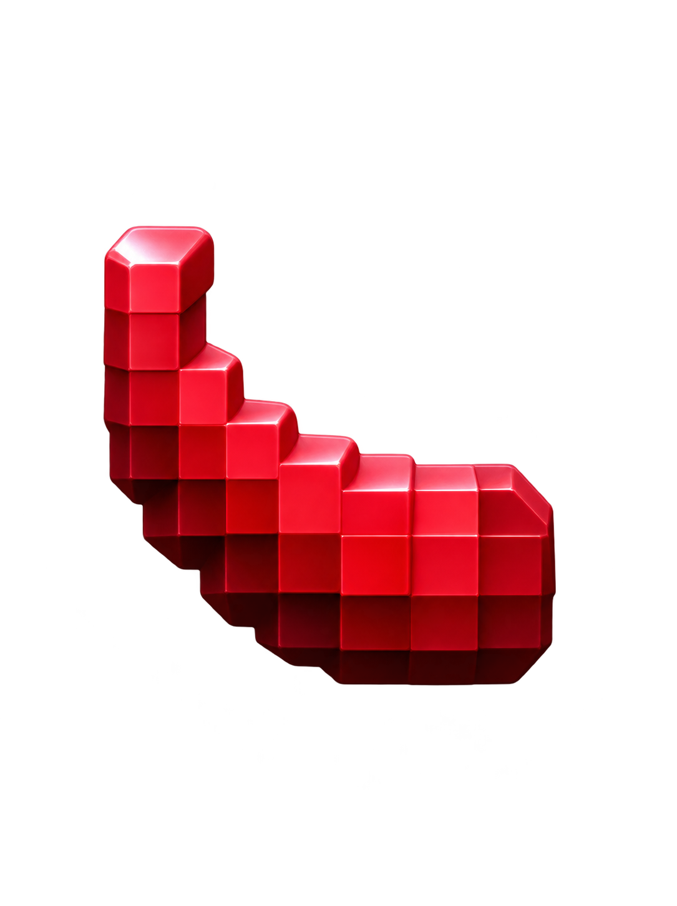

Raw transparent standalone component; generated canvas differs from625x835 and requires production alignment. Gold base/frame/lettering intentionally shared between WILD variants. Alpha predominantly252–253 on solid forms, not literal255; some raw generator edge fringes remain and need production cleanup. No exact parent-coordinate registration claimed.

## ART-051 · 惡魔大WILD／右角

狀態：獨立設計候選稿。尺寸：1085 × 1450。

[獨立檔案](../wild/devil/layers/12.png)

Raw transparent standalone component; generated canvas differs from625x835 and requires production alignment. Gold base/frame/lettering intentionally shared between WILD variants. Alpha predominantly252–253 on solid forms, not literal255; some raw generator edge fringes remain and need production cleanup. No exact parent-coordinate registration claimed.

## ART-052 · 惡魔大WILD／紫色泡泡

狀態：獨立設計候選稿。尺寸：1536 × 1024。

[獨立檔案](../wild/devil/layers/13.png)

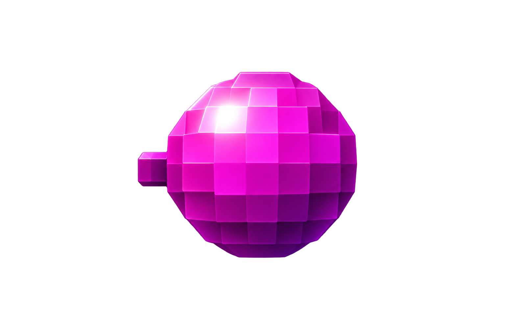

Raw transparent standalone component; generated canvas differs from625x835 and requires production alignment. Alpha predominantly252–253 on solid forms, not literal255; some raw generator edge fringes remain and need production cleanup. No exact parent-coordinate registration claimed.

## ART-053 · 惡魔大WILD／眨眼替換圖

狀態：獨立設計候選稿。尺寸：1536 × 1024。

[獨立檔案](../wild/devil/layers/14.png)

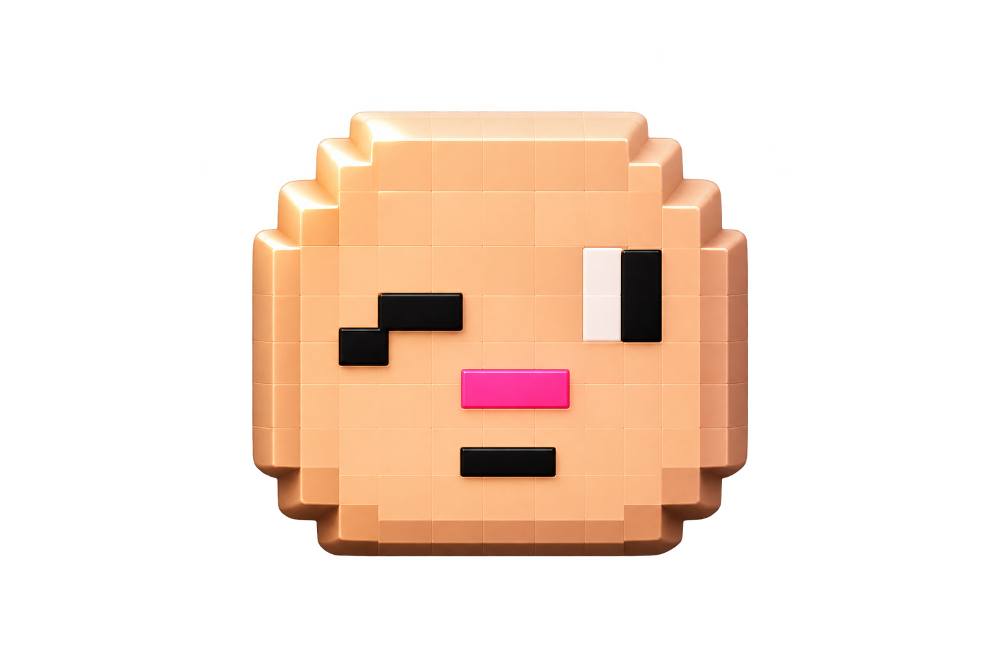

Raw transparent standalone component; generated canvas differs from625x835 and requires production alignment. Alpha predominantly252–253 on solid forms, not literal255; some raw generator edge fringes remain and need production cleanup. No exact parent-coordinate registration claimed.
