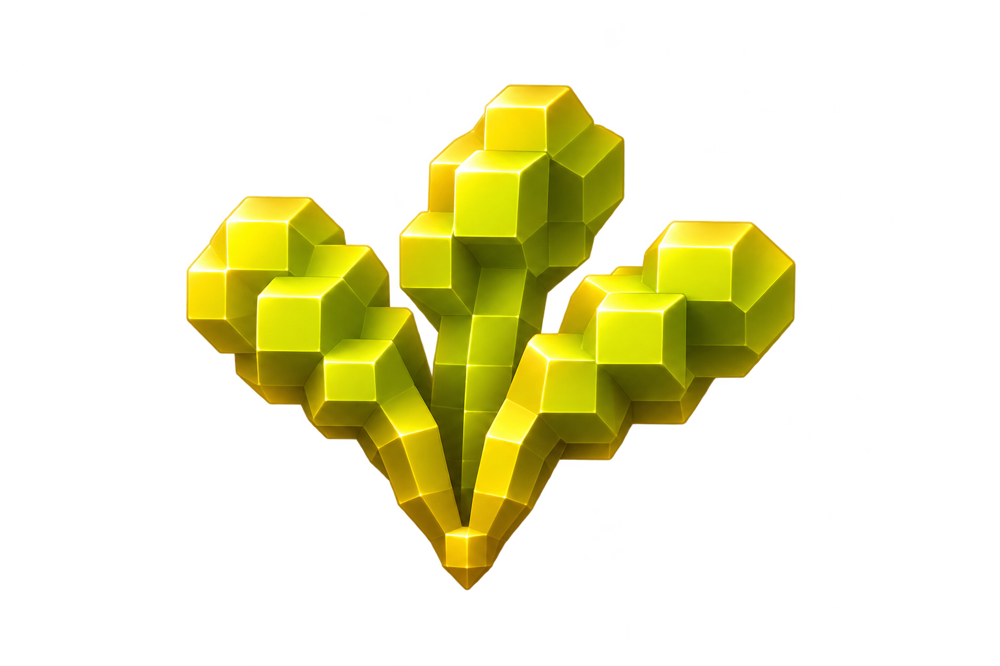
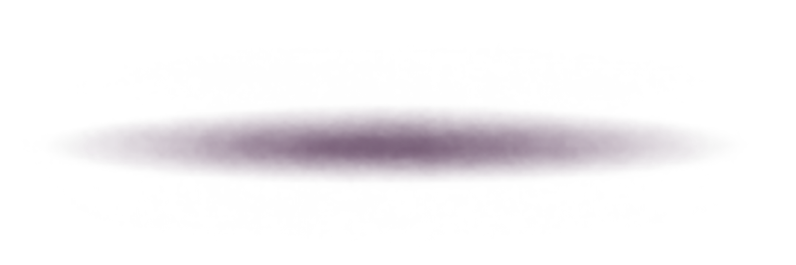
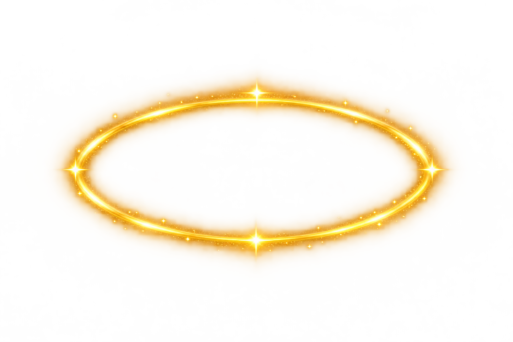

# CARROT分層

[返回總覽](../README.md)

## ART-055 · 金蘿蔔本體

狀態：獨立設計候選稿。尺寸：1536 × 1024。

[獨立檔案](../carrot/layers/body.png)

Raw transparent standalone component; generated canvas differs from625x835 and requires production alignment. Alpha predominantly252–253 on solid forms, not literal255; some raw generator edge fringes remain and need production cleanup. No exact parent-coordinate registration claimed.

## ART-056 · 金色葉冠

狀態：獨立設計候選稿。尺寸：1536 × 1024。

[獨立檔案](../carrot/layers/leaves.png)

Raw transparent standalone component; generated canvas differs from625x835 and requires production alignment. Alpha predominantly252–253 on solid forms, not literal255; some raw generator edge fringes remain and need production cleanup. No exact parent-coordinate registration claimed.

## ART-057 · CARROT大型字樣

狀態：獨立設計候選稿。尺寸：2172 × 724。

[獨立檔案](../carrot/layers/wordmark.png)

Raw transparent standalone component; generated canvas differs from625x835 and requires production alignment. Alpha predominantly252–253 on solid forms, not literal255; some raw generator edge fringes remain and need production cleanup. No exact parent-coordinate registration claimed.

## ART-058 · 寶石裝飾

狀態：獨立設計候選稿。尺寸：1024 × 1536。

[獨立檔案](../carrot/layers/gem.png)

Raw transparent standalone component; generated canvas differs from625x835 and requires production alignment. Alpha predominantly252–253 on solid forms, not literal255; some raw generator edge fringes remain and need production cleanup. No exact parent-coordinate registration claimed.

## ART-059 · 落地接觸陰影

狀態：獨立設計候選稿。尺寸：2172 × 724。

[獨立檔案](../carrot/layers/contact-shadow.png)

Regenerated without source reference after QA rejected unwanted full carrot. Standalone contact shadow candidate, tune opacity during compositing. Alpha predominantly252–253 on solid forms, not literal255; some raw generator edge fringes remain and need production cleanup. No exact parent-coordinate registration claimed.

## ART-060 · 掃光遮罩

狀態：獨立設計候選稿。尺寸：1536 × 1024。

[獨立檔案](../carrot/layers/glint-mask.png)

Raw transparent standalone component; generated canvas differs from625x835 and requires production alignment. Alpha predominantly252–253 on solid forms, not literal255; some raw generator edge fringes remain and need production cleanup. No exact parent-coordinate registration claimed.

## ART-061 · 光圈

狀態：獨立設計候選稿。尺寸：1536 × 1024。

[獨立檔案](../carrot/layers/aura.png)

Raw transparent standalone component; generated canvas differs from625x835 and requires production alignment. Alpha predominantly252–253 on solid forms, not literal255; some raw generator edge fringes remain and need production cleanup. No exact parent-coordinate registration claimed.

## ART-062 · 跳動拖尾

狀態：獨立設計候選稿。尺寸：1536 × 1024。

[獨立檔案](../carrot/layers/trail.png)

Raw transparent standalone component; generated canvas differs from625x835 and requires production alignment. Alpha predominantly252–253 on solid forms, not literal255; some raw generator edge fringes remain and need production cleanup. No exact parent-coordinate registration claimed.

## ART-063 · 觸發爆光

狀態：獨立設計候選稿。尺寸：1536 × 1024。

[獨立檔案](../carrot/layers/trigger-burst.png)

Raw transparent standalone component; generated canvas differs from625x835 and requires production alignment. Alpha predominantly252–253 on solid forms, not literal255; some raw generator edge fringes remain and need production cleanup. No exact parent-coordinate registration claimed.
