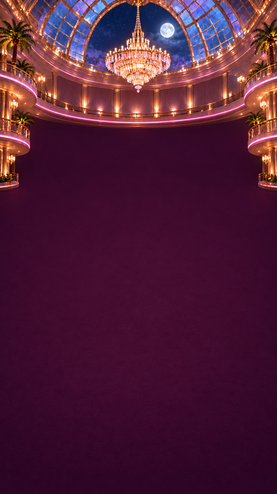
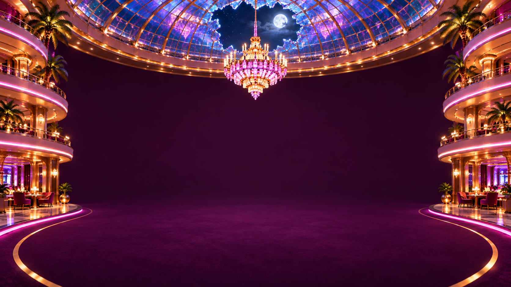
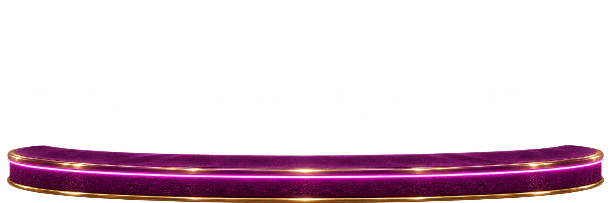
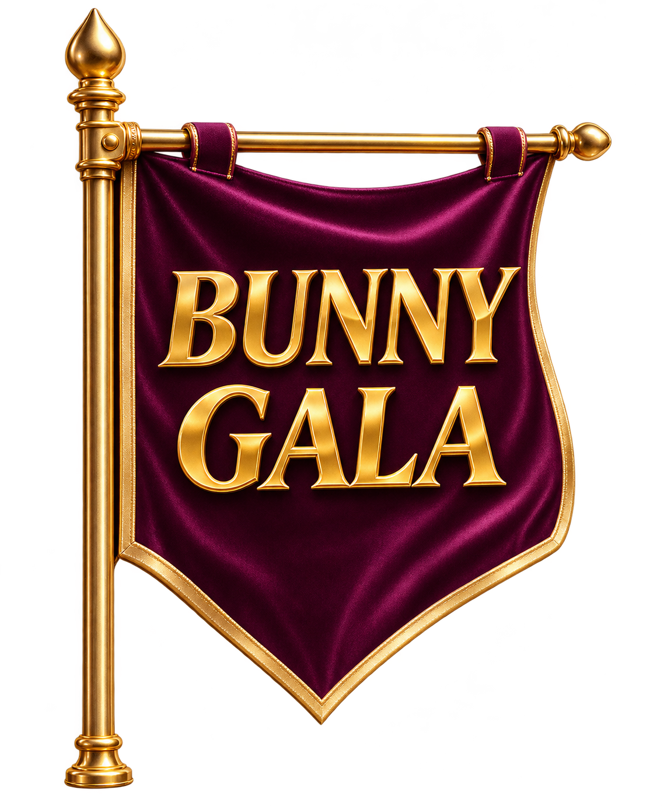
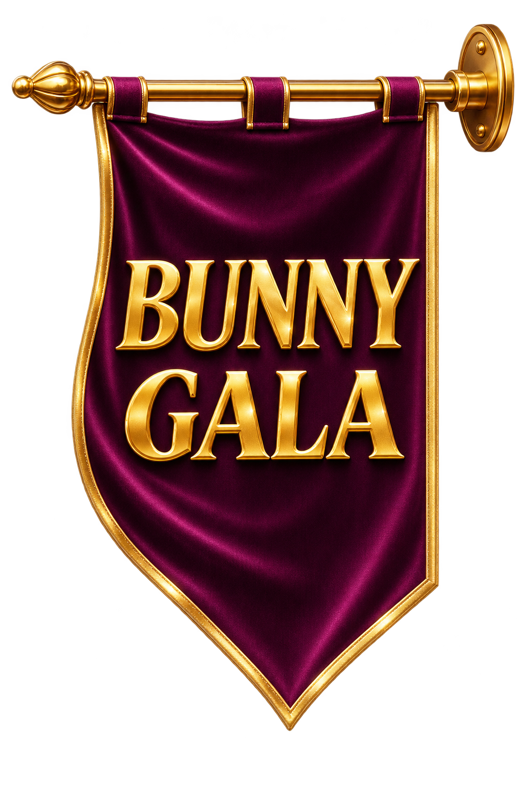
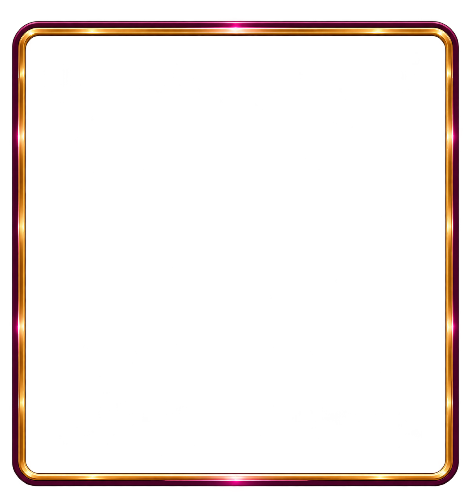

# 場景與盤面

[返回總覽](../README.md)

## ART-064 · 直屏主背景

狀態：獨立設計候選稿。尺寸：941 × 1672。

[獨立檔案](../scene/portrait-background.png)

Independent image-generated art candidate; final visual approval, shared canvas alignment and production export not verified. Native dimensions 941x1672; mode RGB.

## ART-065 · 橫屏主背景

狀態：獨立設計候選稿。尺寸：1672 × 941。

[獨立檔案](../scene/landscape-background.png)

Independent image-generated art candidate; final visual approval, shared canvas alignment and production export not verified. Native dimensions 1672x941; mode RGB.

## ART-066 · 前景舞台

狀態：獨立設計候選稿。尺寸：2172 × 724。

[獨立檔案](../scene/foreground.png)

Independent image-generated art candidate; final visual approval, shared canvas alignment and production export not verified. Native dimensions 2172x724; mode RGBA. Alpha range (0, 255); bbox (19, 37, 2156, 724).

## ART-067 · 遠景柔光

狀態：獨立設計候選稿。尺寸：941 × 1671。

[獨立檔案](../scene/ambient-light.png)

Independent image-generated art candidate; final visual approval, shared canvas alignment and production export not verified. Native dimensions 941x1671; mode RGBA. Alpha range (0, 252); bbox (0, 0, 941, 1671).

## ART-068 · 左側BUNNY GALA旗

狀態：獨立設計候選稿。尺寸：1138 × 1382。

[獨立檔案](../scene/flag-left.png)

Independent image-generated art candidate; final visual approval, shared canvas alignment and production export not verified. Native dimensions 1138x1382; mode RGBA. Alpha range (0, 255); bbox (0, 0, 1134, 1382). BUNNY GALA text candidate; lettering needs visual review.

## ART-069 · 右側BUNNY GALA旗

狀態：獨立設計候選稿。尺寸：1024 × 1536。

[獨立檔案](../scene/flag-right.png)

Independent image-generated art candidate; final visual approval, shared canvas alignment and production export not verified. Native dimensions 1024x1536; mode RGBA. Alpha range (0, 254); bbox (0, 20, 1014, 1514). BUNNY GALA text candidate; lettering needs visual review.

## ART-070 · 盤面外框

狀態：獨立設計候選稿。尺寸：1213 × 1296。

[獨立檔案](../scene/board-frame.png)

Independent image-generated art candidate; final visual approval, shared canvas alignment and production export not verified. Native dimensions 1213x1296; mode RGBA. Alpha range (0, 255); bbox (23, 44, 1193, 1266).

## ART-071 · 盤面內襯

狀態：獨立設計候選稿。尺寸：1196 × 1315。

[獨立檔案](../scene/board-felt-v2.png)

Independent image-generated art candidate; final visual approval, shared canvas alignment and production export not verified. Native dimensions 1213x1296; mode RGBA. Alpha range (0, 255); bbox (0, 0, 1212, 1296).

## ART-072 · 盤面遮罩

狀態：獨立設計候選稿。尺寸：1214 × 1295。

[獨立檔案](../scene/board-mask.png)

Independent image-generated art candidate; final visual approval, shared canvas alignment and production export not verified. Native dimensions 1214x1295; mode RGBA. Alpha range (0, 255); bbox (0, 0, 1214, 1295). Uncalibrated generated alpha silhouette; integration mask alignment must be verified against final canvas.
