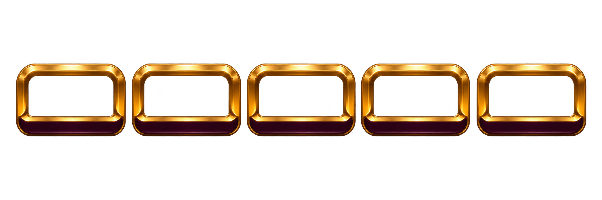
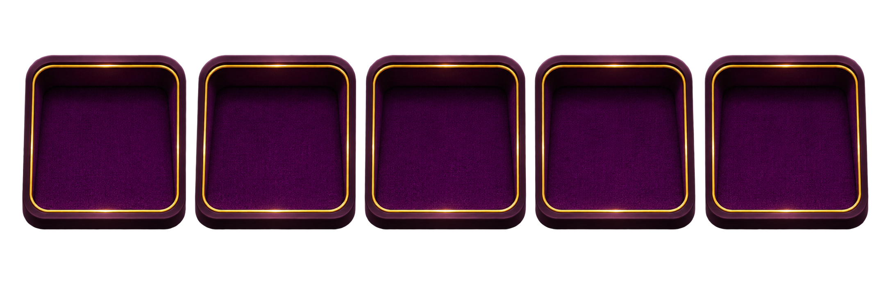
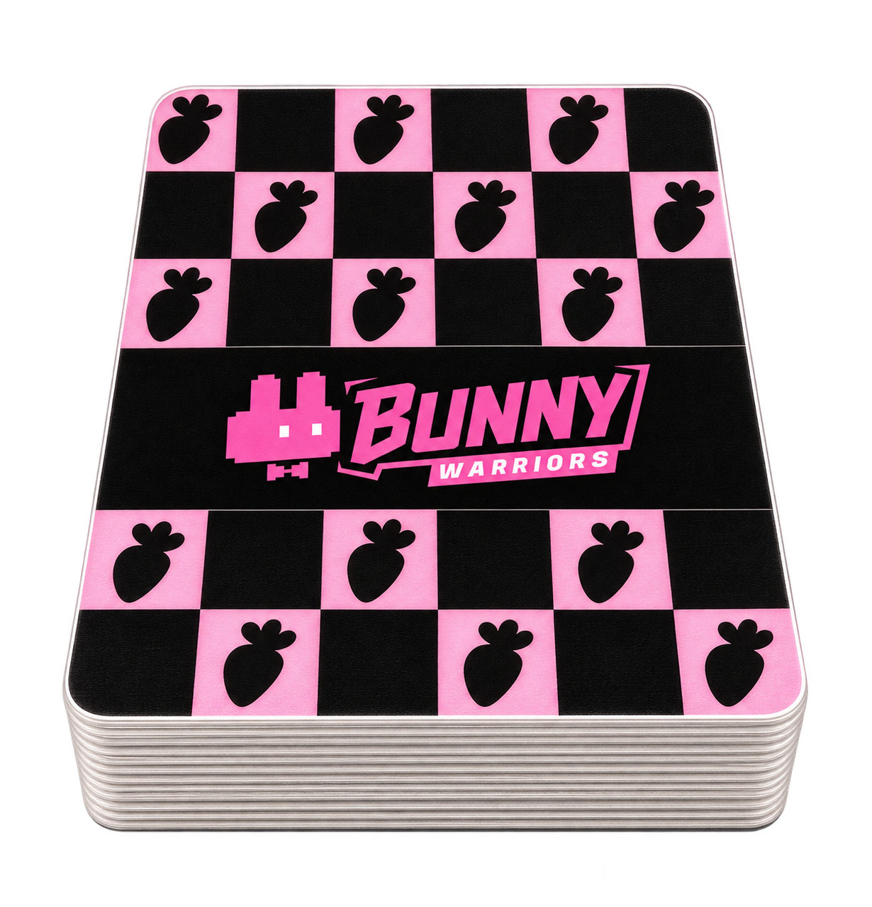
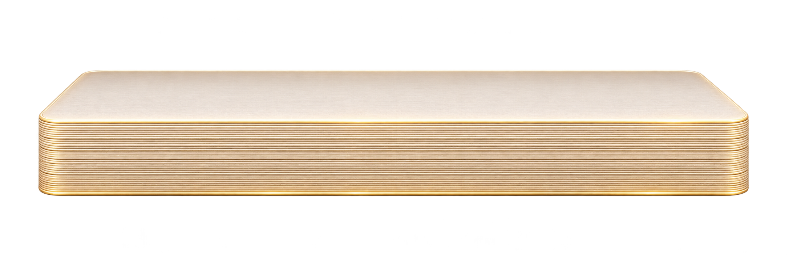

# 發牌器

[返回總覽](../README.md)

## ART-073 · 機身

狀態：獨立設計候選稿。尺寸：2172 × 724。

[獨立檔案](../dealer/housing.png)

Independent image-generated art candidate; final visual approval, shared canvas alignment and production export not verified. Native dimensions 2172x724; mode RGBA. Alpha range (0, 255); bbox (34, 0, 2154, 724).

## ART-074 · 上蓋

狀態：獨立設計候選稿。尺寸：2172 × 724。

[獨立檔案](../dealer/lid.png)

Independent image-generated art candidate; final visual approval, shared canvas alignment and production export not verified. Native dimensions 2172x724; mode RGBA. Alpha range (0, 255); bbox (9, 0, 2160, 708).

## ART-075 · 五個卡槽前擋

狀態：獨立設計候選稿。尺寸：2172 × 724。

[獨立檔案](../dealer/slot-front.png)

Independent image-generated art candidate; final visual approval, shared canvas alignment and production export not verified. Native dimensions 2172x724; mode RGBA. Alpha range (0, 255); bbox (31, 7, 2154, 700).

## ART-076 · 卡槽內襯

狀態：獨立設計候選稿。尺寸：2172 × 724。

[獨立檔案](../dealer/slot-inset.png)

Independent image-generated art candidate; final visual approval, shared canvas alignment and production export not verified. Native dimensions 2172x724; mode RGBA. Alpha range (0, 255); bbox (19, 48, 2140, 698).

## ART-077 · 可見牌堆

狀態：獨立設計候選稿。尺寸：1230 × 1278。

[獨立檔案](../dealer/deck-stack.png)

Independent image-generated art candidate; final visual approval, shared canvas alignment and production export not verified. Native dimensions 1230x1278; mode RGBA. Alpha range (0, 255); bbox (33, 21, 1186, 1278). BACK referenced to original, but generated lettering/geometry fidelity needs review before replacing exact texture.

## ART-078 · 卡堆側邊

狀態：獨立設計候選稿。尺寸：2172 × 724。

[獨立檔案](../dealer/deck-edge.png)

Independent image-generated art candidate; final visual approval, shared canvas alignment and production export not verified. Native dimensions 2172x724; mode RGBA. Alpha range (0, 255); bbox (96, 32, 2166, 724).

## ART-079 · 單張出牌遮罩

狀態：獨立設計候選稿。尺寸：2172 × 724。

[獨立檔案](../dealer/release-mask.png)

Independent image-generated art candidate; final visual approval, shared canvas alignment and production export not verified. Native dimensions 2172x724; mode RGBA. Alpha range (0, 255); bbox (0, 21, 2160, 700). Uncalibrated generated alpha silhouette; integration mask alignment must be verified against final canvas.

## ART-080 · 粉紅指示燈

狀態：獨立設計候選稿。尺寸：2172 × 724。

[獨立檔案](../dealer/indicator.png)

Independent image-generated art candidate; final visual approval, shared canvas alignment and production export not verified. Native dimensions 2172x724; mode RGBA. Alpha range (0, 254); bbox (19, 17, 2166, 724).

## ART-081 · 金屬掃光

狀態：獨立設計候選稿。尺寸：2172 × 724。

[獨立檔案](../dealer/metal-glint.png)

Independent image-generated art candidate; final visual approval, shared canvas alignment and production export not verified. Native dimensions 2172x724; mode RGBA. Alpha range (0, 254); bbox (43, 9, 2148, 707).

## ART-082 · 前景遮擋層

狀態：獨立設計候選稿。尺寸：2172 × 724。

[獨立檔案](../dealer/front-occluder.png)

Independent image-generated art candidate; final visual approval, shared canvas alignment and production export not verified. Native dimensions 2172x724; mode RGBA. Alpha range (0, 255); bbox (0, 81, 2142, 682).
