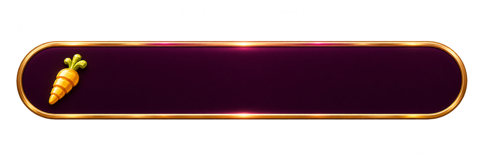
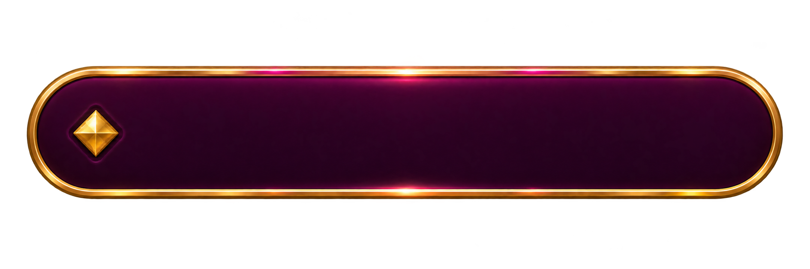
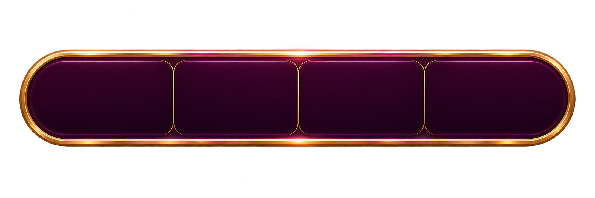
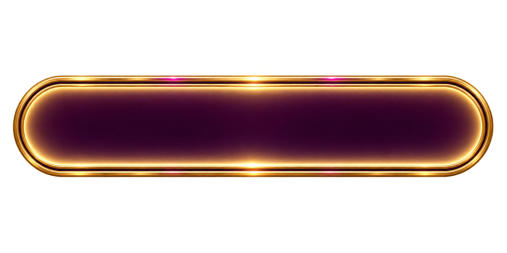
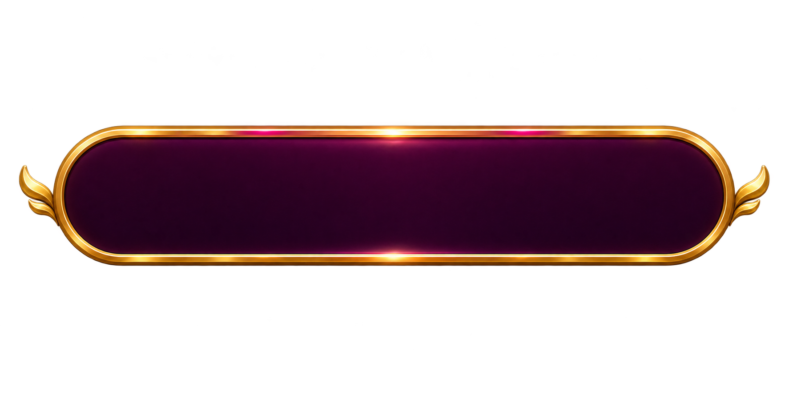
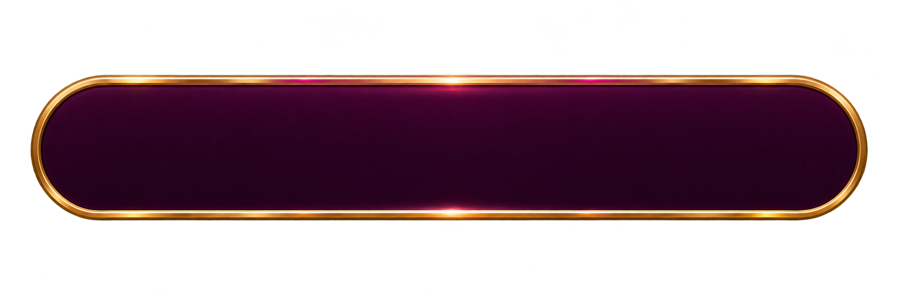
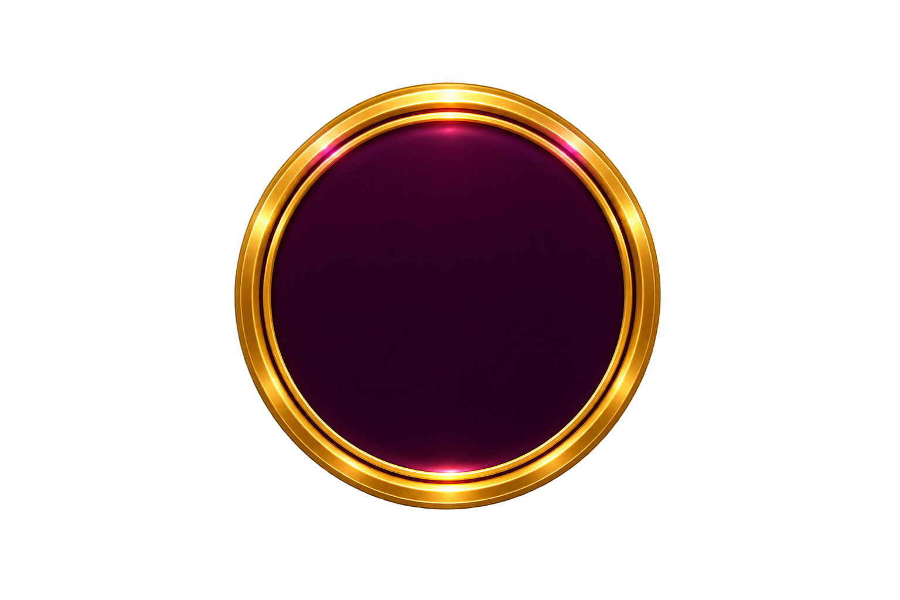
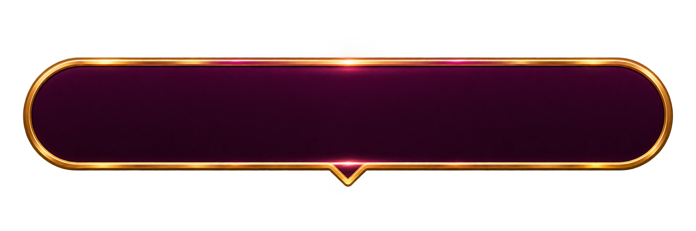

# HUD

[返回總覽](../README.md)

## ART-083 · 餘額面板

狀態：獨立設計候選稿。尺寸：2172 × 724。

[獨立檔案](../ui/hud/balance-panel.png)

Independent normal-state generated art. Runtime text separate. Additional interaction states pending where applicable; transparency and 9slice need integration QA.

## ART-084 · 下注面板

狀態：獨立設計候選稿。尺寸：2172 × 724。

[獨立檔案](../ui/hud/bet-panel.png)

Independent normal-state generated art. Runtime text separate. Additional interaction states pending where applicable; transparency and 9slice need integration QA.

## ART-085 · 獎勵面板

狀態：獨立設計候選稿。尺寸：2172 × 724。

[獨立檔案](../ui/hud/win-panel.png)

Independent normal-state generated art. Runtime text separate. Additional interaction states pending where applicable; transparency and 9slice need integration QA.

## ART-086 · 倍率軌道

狀態：獨立設計候選稿。尺寸：2172 × 724。

[獨立檔案](../ui/hud/multiplier-rail.png)

Independent normal-state generated art. Runtime text separate. Additional interaction states pending where applicable; transparency and 9slice need integration QA.

## ART-087 · 倍率高亮

狀態：獨立設計候選稿。尺寸：1774 × 887。

[獨立檔案](../ui/hud/multiplier-active.png)

Independent normal-state generated art. Runtime text separate. Additional interaction states pending where applicable; transparency and 9slice need integration QA.

## ART-088 · 免費次數面板

狀態：獨立設計候選稿。尺寸：1774 × 887。

[獨立檔案](../ui/hud/free-counter.png)

Independent normal-state generated art. Runtime text separate. Additional interaction states pending where applicable; transparency and 9slice need integration QA.

## ART-089 · 狀態訊息帶

狀態：獨立設計候選稿。尺寸：2172 × 724。

[獨立檔案](../ui/hud/status-panel.png)

Independent normal-state generated art. Runtime text separate. Additional interaction states pending where applicable; transparency and 9slice need integration QA.

## ART-090 · Auto剩餘次數徽章

狀態：獨立設計候選稿。尺寸：1536 × 1024。

[獨立檔案](../ui/hud/auto-count-badge.png)

Independent normal-state generated art. Runtime text separate. Additional interaction states pending where applicable; transparency and 9slice need integration QA.

## ART-091 · 最高下注提示

狀態：獨立設計候選稿。尺寸：2172 × 724。

[獨立檔案](../ui/hud/bet-limit-tooltip.png)

Independent normal-state generated art. Runtime text separate. Additional interaction states pending where applicable; transparency and 9slice need integration QA.
