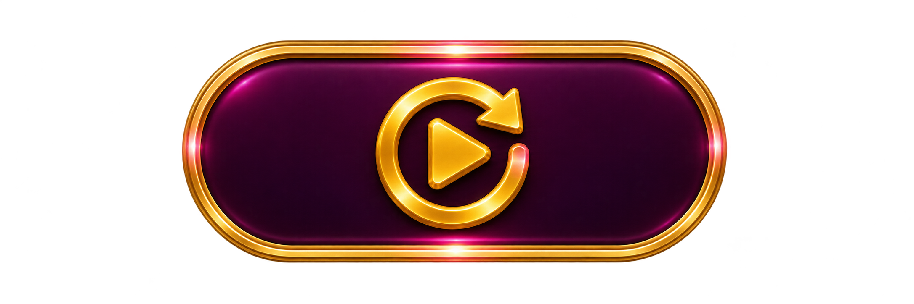
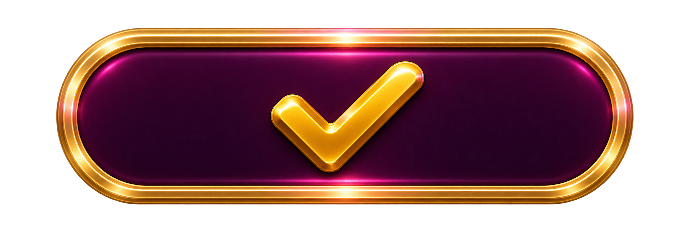
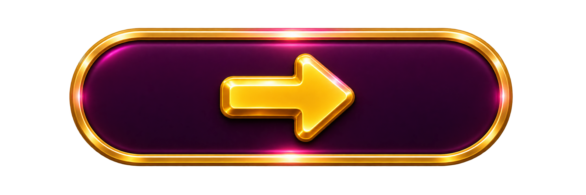

# 按鈕與圖標

[返回總覽](../README.md)

## ART-092 · Spin

狀態：獨立設計候選稿。尺寸：1536 × 1024。

[獨立檔案](../ui/buttons/spin/normal.png)

Independent normal-state generated art. Runtime text separate. Additional interaction states pending where applicable; transparency and 9slice need integration QA.

## ART-093 · 停止旋轉提示

狀態：獨立設計候選稿。尺寸：1536 × 1024。

[獨立檔案](../ui/buttons/stop/normal.png)

Independent normal-state generated art. Runtime text separate. Additional interaction states pending where applicable; transparency and 9slice need integration QA.

## ART-094 · 下注加

狀態：獨立設計候選稿。尺寸：1312 × 1199。

[獨立檔案](../ui/buttons/bet-plus/normal.png)

Independent normal-state generated art. Runtime text separate. Additional interaction states pending where applicable; transparency and 9slice need integration QA.

## ART-095 · 下注減

狀態：獨立設計候選稿。尺寸：1263 × 1246。

[獨立檔案](../ui/buttons/bet-minus/normal.png)

Independent normal-state generated art. Runtime text separate. Additional interaction states pending where applicable; transparency and 9slice need integration QA.

## ART-096 · Auto Play

狀態：獨立設計候選稿。尺寸：2172 × 724。

[獨立檔案](../ui/buttons/auto/normal.png)

Independent normal-state generated art. Runtime text separate. Additional interaction states pending where applicable; transparency and 9slice need integration QA.

## ART-097 · Speed正常

狀態：獨立設計候選稿。尺寸：1312 × 1199。

[獨立檔案](../ui/buttons/speed-normal/normal.png)

Independent normal-state generated art. Runtime text separate. Additional interaction states pending where applicable; transparency and 9slice need integration QA.

## ART-098 · Speed快速

狀態：獨立設計候選稿。尺寸：1312 × 1199。

[獨立檔案](../ui/buttons/speed-fast/normal.png)

Independent normal-state generated art. Runtime text separate. Additional interaction states pending where applicable; transparency and 9slice need integration QA.

## ART-099 · Speed極速

狀態：獨立設計候選稿。尺寸：1312 × 1199。

[獨立檔案](../ui/buttons/speed-max/normal.png)

Independent normal-state generated art. Runtime text separate. Additional interaction states pending where applicable; transparency and 9slice need integration QA.

## ART-100 · 玩法Info

狀態：獨立設計候選稿。尺寸：1312 × 1199。

[獨立檔案](../ui/buttons/info/normal.png)

Independent normal-state generated art. Runtime text separate. Additional interaction states pending where applicable; transparency and 9slice need integration QA.

## ART-101 · 設定

狀態：獨立設計候選稿。尺寸：1312 × 1199。

[獨立檔案](../ui/buttons/settings/normal.png)

Independent normal-state generated art. Runtime text separate. Additional interaction states pending where applicable; transparency and 9slice need integration QA.

## ART-102 · 音效開

狀態：獨立設計候選稿。尺寸：1312 × 1199。

[獨立檔案](../ui/buttons/sound-on/normal.png)

Independent normal-state generated art. Runtime text separate. Additional interaction states pending where applicable; transparency and 9slice need integration QA.

## ART-103 · 音效關

狀態：獨立設計候選稿。尺寸：1312 × 1199。

[獨立檔案](../ui/buttons/sound-off/normal.png)

Independent normal-state generated art. Runtime text separate. Additional interaction states pending where applicable; transparency and 9slice need integration QA.

## ART-104 · 關閉

狀態：獨立設計候選稿。尺寸：1312 × 1199。

[獨立檔案](../ui/buttons/close/normal.png)

Independent normal-state generated art. Runtime text separate. Additional interaction states pending where applicable; transparency and 9slice need integration QA.

## ART-105 · 返回

狀態：獨立設計候選稿。尺寸：1312 × 1199。

[獨立檔案](../ui/buttons/back/normal.png)

Independent normal-state generated art. Runtime text separate. Additional interaction states pending where applicable; transparency and 9slice need integration QA.

## ART-106 · 主要確認

狀態：獨立設計候選稿。尺寸：2172 × 724。

[獨立檔案](../ui/buttons/primary/normal.png)

Independent normal-state generated art. Runtime text separate. Additional interaction states pending where applicable; transparency and 9slice need integration QA.

## ART-107 · 取消

狀態：獨立設計候選稿。尺寸：1774 × 887。

[獨立檔案](../ui/buttons/cancel/normal.png)

Independent normal-state generated art. Runtime text separate. Additional interaction states pending where applicable; transparency and 9slice need integration QA.

## ART-108 · 下一步

狀態：獨立設計候選稿。尺寸：2172 × 724。

[獨立檔案](../ui/buttons/next/normal.png)

Independent normal-state generated art. Runtime text separate. Additional interaction states pending where applicable; transparency and 9slice need integration QA.

## ART-109 · 跳過

狀態：獨立設計候選稿。尺寸：1774 × 887。

[獨立檔案](../ui/buttons/skip/normal.png)

Independent normal-state generated art. Runtime text separate. Additional interaction states pending where applicable; transparency and 9slice need integration QA.

## ART-110 · 重看

狀態：獨立設計候選稿。尺寸：1312 × 1199。

[獨立檔案](../ui/buttons/replay/normal.png)

Independent normal-state generated art. Runtime text separate. Additional interaction states pending where applicable; transparency and 9slice need integration QA.

## ART-111 · 重試

狀態：獨立設計候選稿。尺寸：1312 × 1199。

[獨立檔案](../ui/buttons/retry/normal.png)

Independent normal-state generated art. Runtime text separate. Additional interaction states pending where applicable; transparency and 9slice need integration QA.
