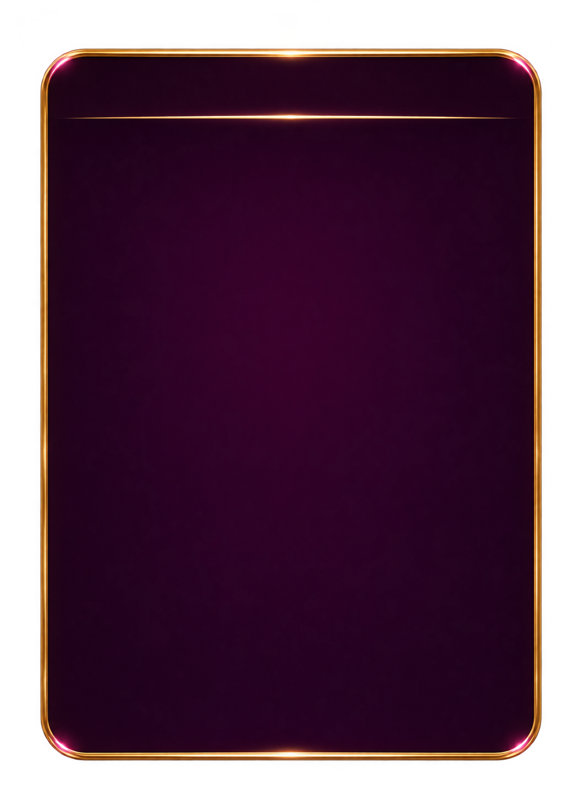
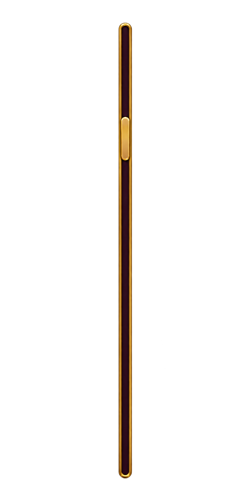

# 共用介面元件

[返回總覽](../README.md)

## ART-112 · 通用彈窗底板

狀態：獨立設計候選稿。尺寸：1064 × 1478。

[獨立檔案](../ui/components/modal/normal.png)

Blank portrait modal backplate; normal state only; no nine-slice metadata yet.

## ART-113 · 彈窗遮罩

狀態：獨立設計候選稿。尺寸：1024 × 1536。

[獨立檔案](../ui/components/scrim/normal.png)

Scrim transparency needs runtime opacity calibration.

## ART-114 · 選項分頁

狀態：獨立設計候選稿。尺寸：2172 × 724。

[獨立檔案](../ui/components/tabs/normal.png)

Single normal/selected art state; other interaction states remain.

## ART-115 · 勾選框

狀態：獨立設計候選稿。尺寸：1536 × 1024。

[獨立檔案](../ui/components/checkbox/normal.png)

Single normal/selected art state; other interaction states remain.

## ART-116 · 開關

狀態：獨立設計候選稿。尺寸：1774 × 887。

[獨立檔案](../ui/components/toggle/normal.png)

Single normal/selected art state; other interaction states remain.

## ART-117 · 數值輸入框

狀態：獨立設計候選稿。尺寸：2172 × 724。

[獨立檔案](../ui/components/input/normal.png)

Single normal/selected art state; other interaction states remain.

## ART-118 · 數值加減組

狀態：獨立設計候選稿。尺寸：2172 × 724。

[獨立檔案](../ui/components/stepper/normal.png)

Single normal/selected art state; other interaction states remain.

## ART-119 · 次數快選鈕

狀態：獨立設計候選稿。尺寸：1774 × 887。

[獨立檔案](../ui/components/spin-preset/normal.png)

Single normal/selected art state; other interaction states remain.

## ART-120 · 捲動指示

狀態：獨立設計候選稿。尺寸：887 × 1774。

[獨立檔案](../ui/components/scroll-indicator/normal.png)

Single normal/selected art state; other interaction states remain.

## ART-121 · 提示Toast

狀態：獨立設計候選稿。尺寸：2172 × 724。

[獨立檔案](../ui/components/toast/normal.png)

Single normal/selected art state; other interaction states remain.

## ART-122 · 載入指示

狀態：獨立設計候選稿。尺寸：1536 × 1024。

[獨立檔案](../ui/components/loading/normal.png)

Static spinner keyframe; animation runtime rotation needed.
