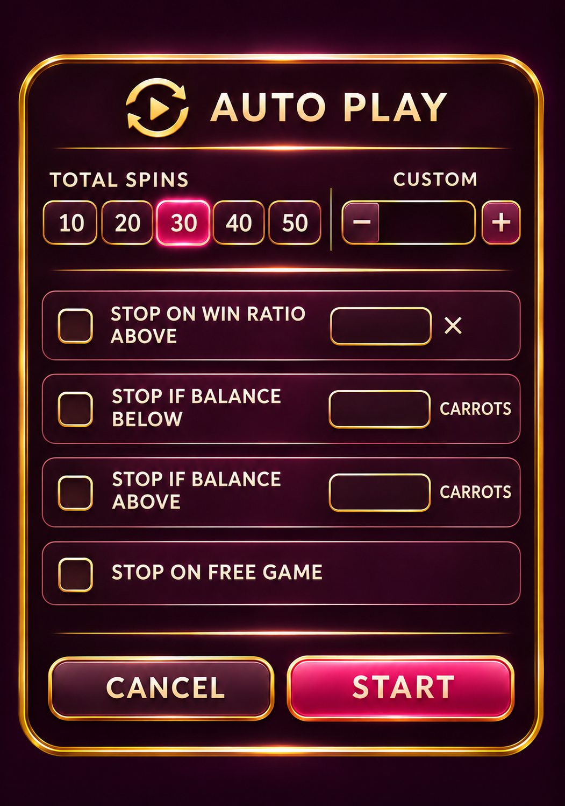
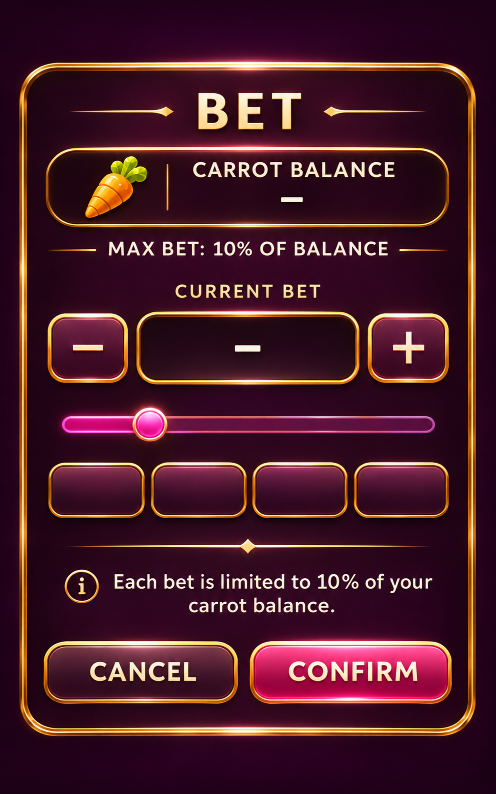
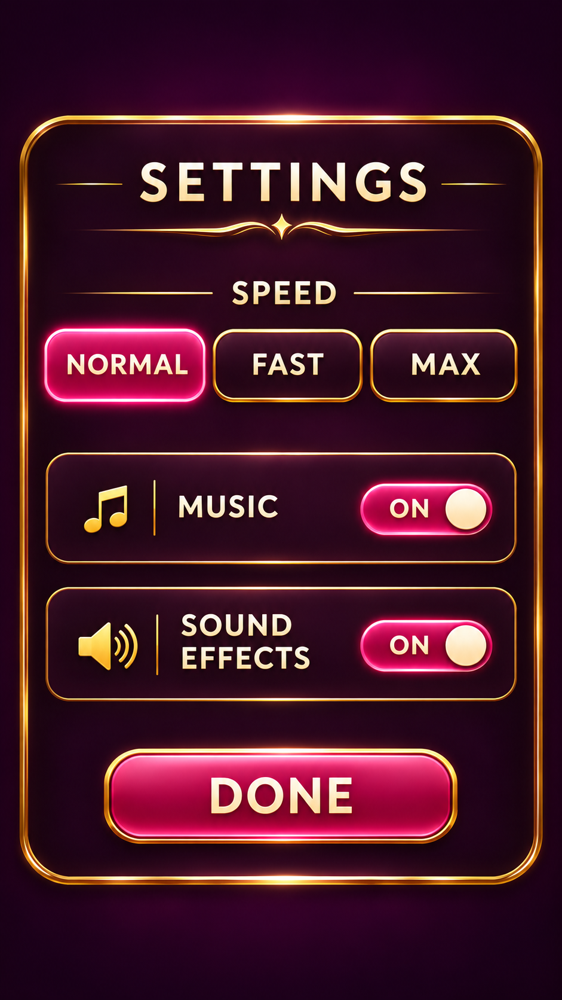
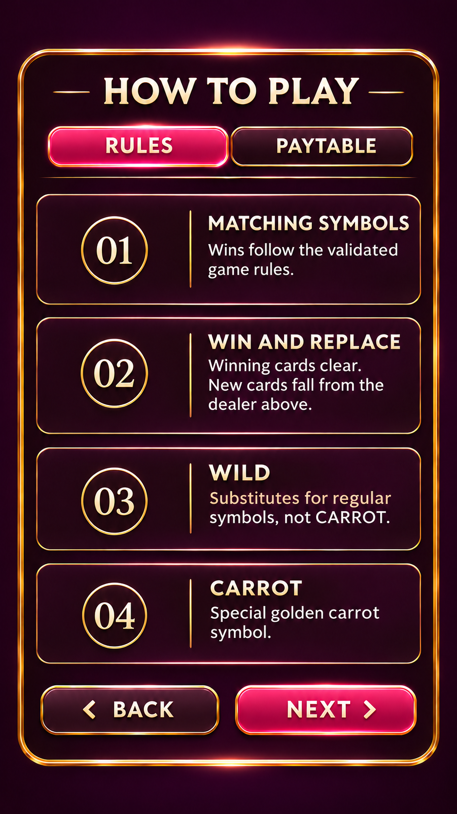
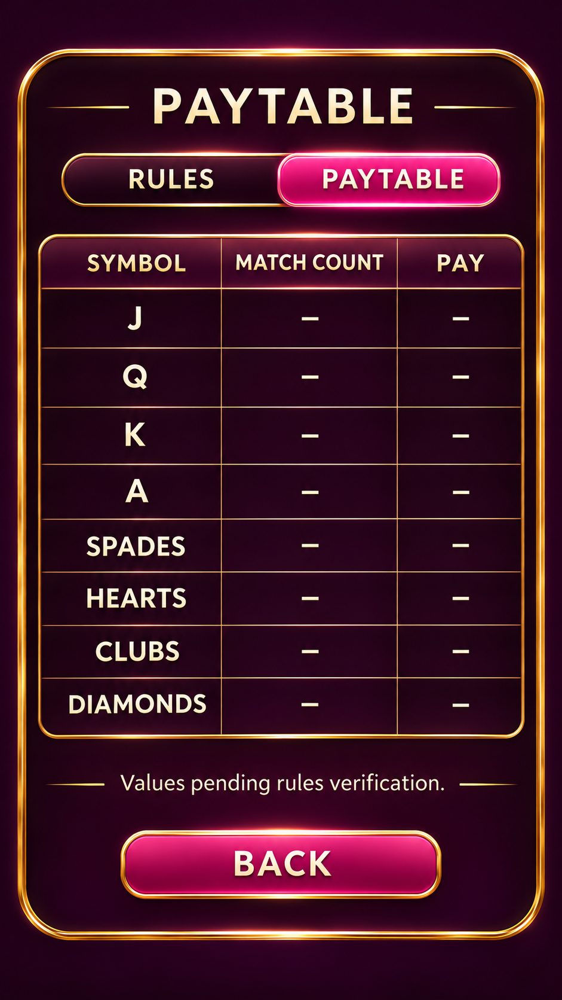
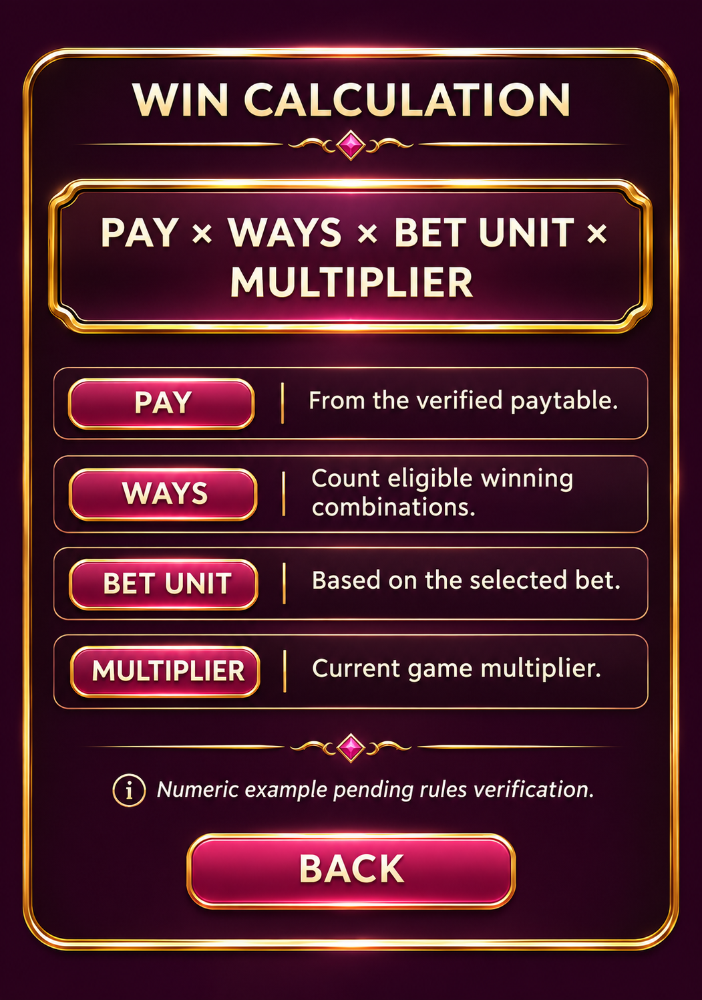
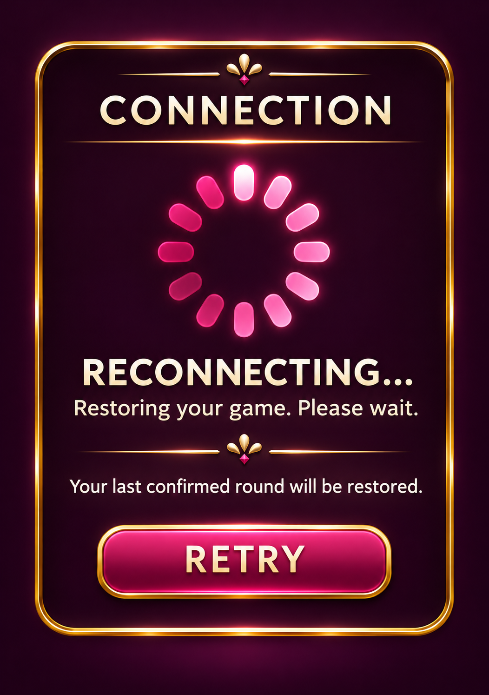
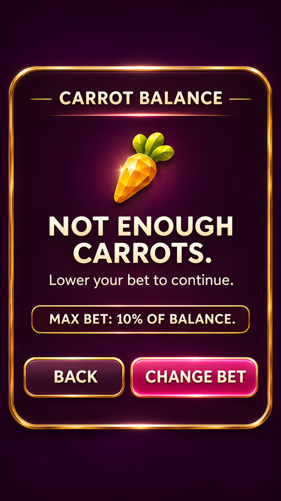
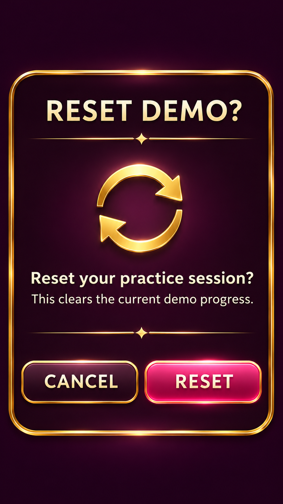

# 功能畫面

[返回總覽](../README.md)

## ART-123 · Auto設定視窗

狀態：獨立設計候選稿。尺寸：1051 × 1496。

[獨立檔案](../screens/auto-settings/layout-portrait.png)

Portrait screen design proof only. Text must be recreated as live/localized UI; landscape and small-screen variants remain.

## ART-124 · 下注選擇與10%上限

狀態：獨立設計候選稿。尺寸：992 × 1586。

[獨立檔案](../screens/bet-selector/layout-portrait.png)

Portrait screen design proof only. Text must be recreated as live/localized UI; landscape and small-screen variants remain.

## ART-125 · 速度與音效設定

狀態：獨立設計候選稿。尺寸：941 × 1672。

[獨立檔案](../screens/settings/layout-portrait.png)

Portrait screen design proof only. Text must be recreated as live/localized UI; landscape and small-screen variants remain.

## ART-126 · 玩法說明

狀態：獨立設計候選稿。尺寸：941 × 1672。

[獨立檔案](../screens/rules/layout-portrait.png)

Portrait screen design proof only. Text must be recreated as live/localized UI; landscape and small-screen variants remain.

## ART-127 · 賠付表

狀態：獨立設計候選稿。尺寸：941 × 1672。

[獨立檔案](../screens/paytable/layout-portrait.png)

Portrait screen design proof only. Text must be recreated as live/localized UI; landscape and small-screen variants remain.

## ART-128 · 計算例子

狀態：獨立設計候選稿。尺寸：1051 × 1496。

[獨立檔案](../screens/calculation-example/layout-portrait.png)

Portrait screen design proof only. Text must be recreated as live/localized UI; landscape and small-screen variants remain.

## ART-129 · 連線／恢復提示

狀態：獨立設計候選稿。尺寸：1052 × 1494。

[獨立檔案](../screens/reconnect/layout-portrait.png)

Portrait screen design proof only. Text must be recreated as live/localized UI; landscape and small-screen variants remain.

## ART-130 · 蘿蔔不足提示

狀態：獨立設計候選稿。尺寸：941 × 1672。

[獨立檔案](../screens/insufficient-balance/layout-portrait.png)

Portrait screen design proof only. Text must be recreated as live/localized UI; landscape and small-screen variants remain.

## ART-131 · 重設試玩確認

狀態：獨立設計候選稿。尺寸：941 × 1672。

[獨立檔案](../screens/reset-confirm/layout-portrait.png)

Portrait screen design proof only. Text must be recreated as live/localized UI; landscape and small-screen variants remain.
