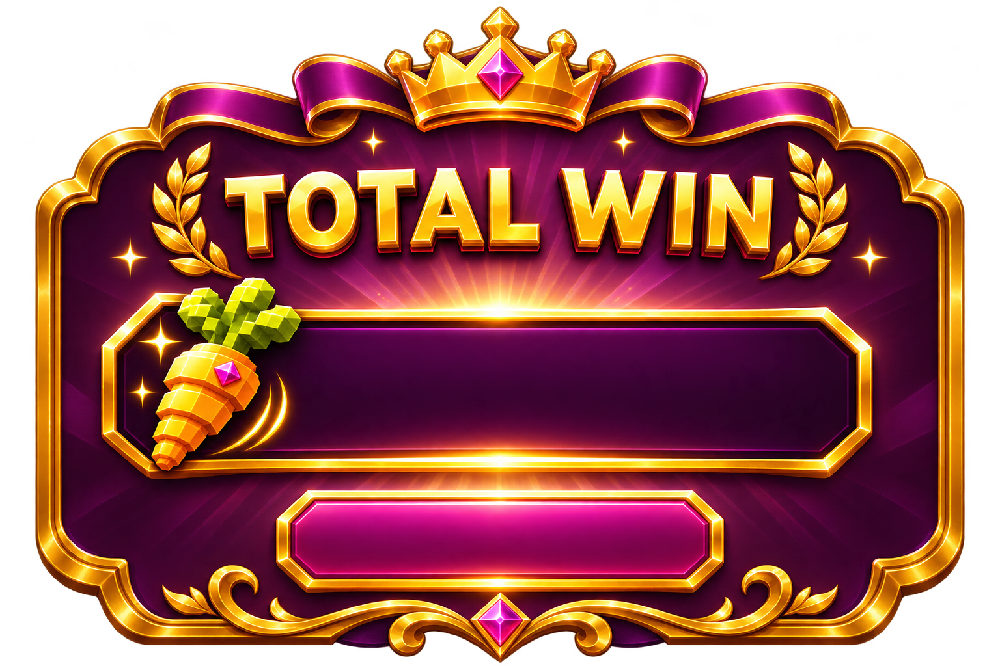
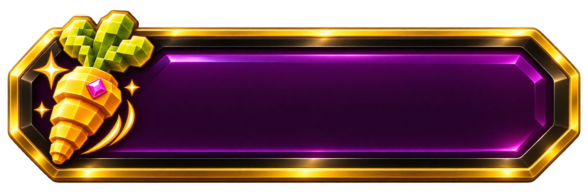

# 獎勵與免費遊戲

[返回總覽](../README.md)

## ART-132 · 免費遊戲進入

狀態：獨立設計候選稿。尺寸：1536 × 1024。

[獨立檔案](../features/free-entry/main.png)

獨立美術候選；非動畫成品。可變數字與本地化文字由實作層覆蓋，未設定獎項門檻。

## ART-133 · 免費模式HUD

狀態：獨立設計候選稿。尺寸：2172 × 724。

[獨立檔案](../features/free-hud/main.png)

獨立美術候選；非動畫成品。可變數字與本地化文字由實作層覆蓋，未設定獎項門檻。

## ART-134 · 追加免費次數

狀態：獨立設計候選稿。尺寸：1536 × 1024。

[獨立檔案](../features/free-extra/main.png)

獨立美術候選；非動畫成品。可變數字與本地化文字由實作層覆蓋，未設定獎項門檻。

## ART-135 · 最後一次提示

狀態：獨立設計候選稿。尺寸：2172 × 724。

[獨立檔案](../features/free-last/main.png)

獨立美術候選；非動畫成品。可變數字與本地化文字由實作層覆蓋，未設定獎項門檻。

## ART-136 · 免費總獎勵結算

狀態：獨立設計候選稿。尺寸：1536 × 1024。

[獨立檔案](../features/free-summary/main.png)

獨立美術候選；非動畫成品。可變數字與本地化文字由實作層覆蓋，未設定獎項門檻。

## ART-137 · 普通得獎

狀態：獨立設計候選稿。尺寸：1774 × 887。

[獨立檔案](../features/win-small/main.png)

獨立美術候選；非動畫成品。可變數字與本地化文字由實作層覆蓋，未設定獎項門檻。

## ART-138 · 大獎標題

狀態：獨立設計候選稿。尺寸：1254 × 1254。

[獨立檔案](../features/win-big/main.png)

獨立美術候選；非動畫成品。可變數字與本地化文字由實作層覆蓋，未設定獎項門檻。

## ART-139 · 更高獎標題

狀態：獨立設計候選稿。尺寸：1254 × 1254。

[獨立檔案](../features/win-epic/main.png)

獨立美術候選；非動畫成品。可變數字與本地化文字由實作層覆蓋，未設定獎項門檻。

## ART-140 · 獎勵數字底板

狀態：獨立設計候選稿。尺寸：2172 × 724。

[獨立檔案](../features/win-counter/main.png)

獨立美術候選；非動畫成品。可變數字與本地化文字由實作層覆蓋，未設定獎項門檻。

## ART-141 · 蘿蔔獎勵粒子

狀態：獨立設計候選稿。尺寸：1254 × 1254。

[獨立檔案](../features/reward-carrot-particles/main.png)

獨立美術候選；非動畫成品。可變數字與本地化文字由實作層覆蓋，未設定獎項門檻。
