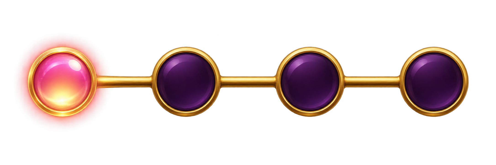

# 新手教學

[返回總覽](../README.md)

## ART-142 · 教學聚光遮罩

狀態：獨立設計候選稿。尺寸：1024 × 1536。

[獨立檔案](../tutorial/spotlight/main.png)

獨立美術候選；非動畫成品。可變數字與本地化文字由實作層覆蓋，未設定獎項門檻。

## ART-143 · 教學指示箭頭

狀態：獨立設計候選稿。尺寸：1024 × 1536。

[獨立檔案](../tutorial/arrow/main.png)

獨立美術候選；非動畫成品。可變數字與本地化文字由實作層覆蓋，未設定獎項門檻。

## ART-144 · 點按指示

狀態：獨立設計候選稿。尺寸：1536 × 1024。

[獨立檔案](../tutorial/tap/main.png)

獨立美術候選；非動畫成品。可變數字與本地化文字由實作層覆蓋，未設定獎項門檻。

## ART-145 · 步驟進度

狀態：獨立設計候選稿。尺寸：2172 × 724。

[獨立檔案](../tutorial/progress/main.png)

獨立美術候選；非動畫成品。可變數字與本地化文字由實作層覆蓋，未設定獎項門檻。

## ART-146 · 示範中獎牌組

狀態：獨立設計候選稿。尺寸：1881 × 836。

[獨立檔案](../tutorial/win-example/main.png)

獨立美術候選；非動畫成品。可變數字與本地化文字由實作層覆蓋，未設定獎項門檻。 教學僅示意首三欄相同黑桃，不表示必須同一行，無賠率值。

## ART-147 · 金牌轉WILD示範

狀態：獨立設計候選稿。尺寸：1536 × 1024。

[獨立檔案](../tutorial/wild-example/main.png)

獨立美術候選；非動畫成品。可變數字與本地化文字由實作層覆蓋，未設定獎項門檻。 教學示意金牌中獎後轉為WILD；非所有金牌立即轉換。

## ART-148 · 三CARROT示範

狀態：獨立設計候選稿。尺寸：1774 × 887。

[獨立檔案](../tutorial/carrot-example/main.png)

獨立美術候選；非動畫成品。可變數字與本地化文字由實作層覆蓋，未設定獎項門檻。

## ART-149 · 四步教學版面

狀態：獨立設計候選稿。尺寸：1199 × 1312。

[獨立檔案](../tutorial/tutorial-layout/main.png)

獨立美術候選；非動畫成品。可變數字與本地化文字由實作層覆蓋，未設定獎項門檻。
