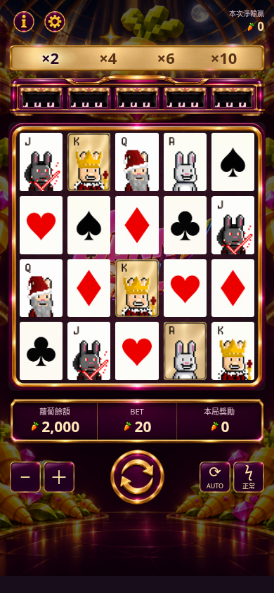

# 免費模式 · 金色倍率底座

恭喜全屏圖已移除×2/×4/×6/×10，聚焦金帽兔子、10次免費遊戲與5秒倒數。

倍率在遊戲主畫面呈現：進入免費模式後，原紫色小圓角矩形底座於1100ms交疊淡入金色；保留同一位置、尺寸及四個倍率。免費模式結束淡回紫色及×1/×2/×3/×5。

獨立素材 `multiplier-free-gold.png` 保留原底座形狀及金框，內部為香檳拉絲金色。`.svg`內嵌PNG並使用同一裁切座標，清楚對齊原尺寸，不靠CSS重新畫底座。

深棕紫字保留金底對比；當前倍率使用更深紫色、更粗字重及明亮背光。×10亦保留原本最高階段較大字體。沒有新增倍率外框。

已實測4個免費倍率、返回普通模式，以及三CARROT→5秒→等待手動開始流程（含2×、暫停、重新整理），並檢查320/440/1440畫面。規則及概率不變。
