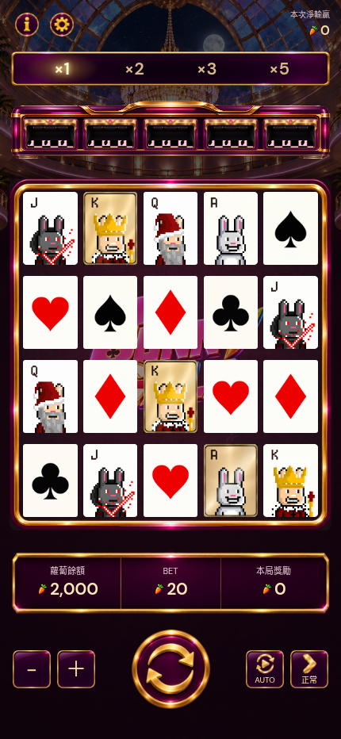
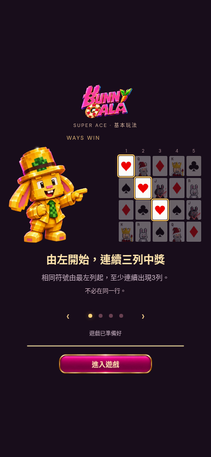
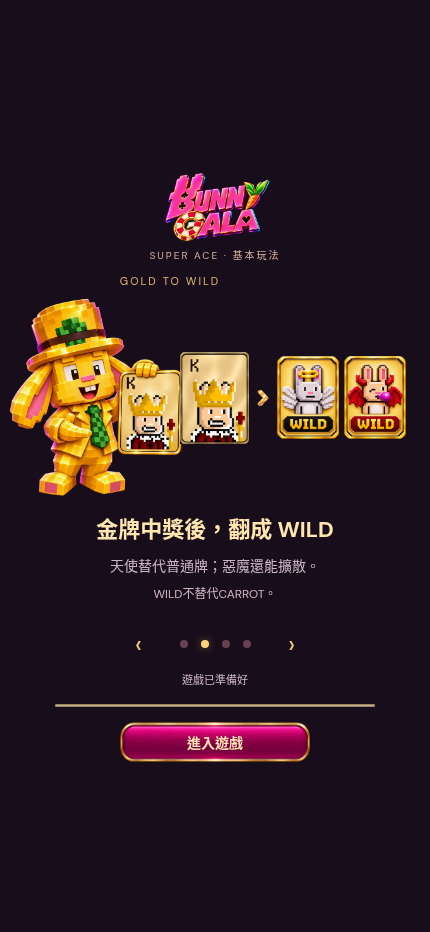
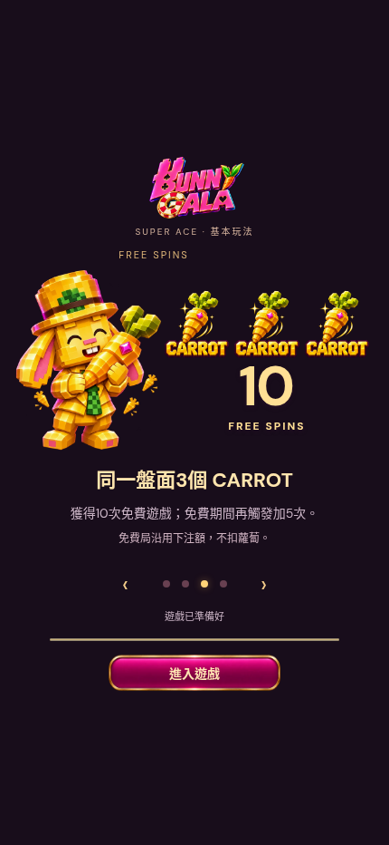
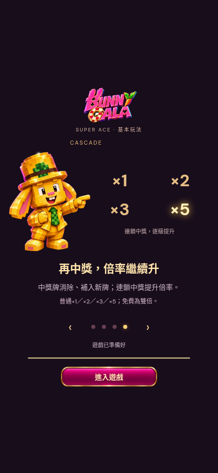

# Portrait layout and rabbit loading lessons

2026-11-10. Reuses the Bunny Gala yellow/gold-hat voxel rabbit, actual approved playing cards, gold frames, WILDs and CARROT art. Three independent transparent mascot PNG masters; runtime uses 640px alpha WebP (total approximately261KB). Text stays live and legible.

## Review

- Fixed portrait screen, controls anchored above the safe bottom; larger ROLL and four equally sized secondary keys. Tall screens increase vertical card gutters and HUD spacing. Short screens use compact controls. Cards retain625:835 proportions; dealer columns remain aligned.
- Four lessons rotate every5.5seconds; manual arrows/dots. First visit may enter as soon as core images decode; no forced countdown. Every visit, including returning and review visits, requires pressing 進入遊戲 after assets are ready. Help→重看教學 reopens the illustrated guide.
- Initial guide images are independent of the core asset gate: a failed mascot does not prevent play. No unloaded core playing card is exposed; critical asset failures retain retry and do not debit the wallet.
- JILI reference: https://jiligames.com/PlusIntro/49?showGame=false and prior repository audit `16_Rewards_History_Performance/OFFICIAL_RULE_CHECK.md`. Current direct page request returned403, so this delivery does not claim a fresh official probability/paytable verification. Lessons describe this game's implemented rules: at least3leftmost consecutive reels; gold winners convert to WILD; WILD excludesCARROT;3CARROTs award10free spins (free retrigger+5); ordinary1/2/3/5, free2/4/6/10.
- No mathematical model or sound behavior changed. Provisional gameplay rating8/10: complete mechanics and onboarding, with real low-end device soak tests and player pacing feedback still needed before a higher rating.

## Verification

`npm test`29passing checks. `qa/portrait-layout.cjs` six sizes320×568 through430×932,20portrait cards, per-axis even gutters, dealer alignment, accessible44pxminimum keys, no document scrolling. `qa/desktop-fit.cjs` five desktop/touch configurations. `qa/loading-guide.cjs` four decoded pages on three touch sizes, entry/replay preserves wallet, mandatory manual entry on both first/returning visits. See prototype QA sources for reproducible checks.

2026-11-10 revision: removed01–04 labels; gold-hat rabbit now holds the approved gold K card. Updated independent PNG master and runtime WebP.
