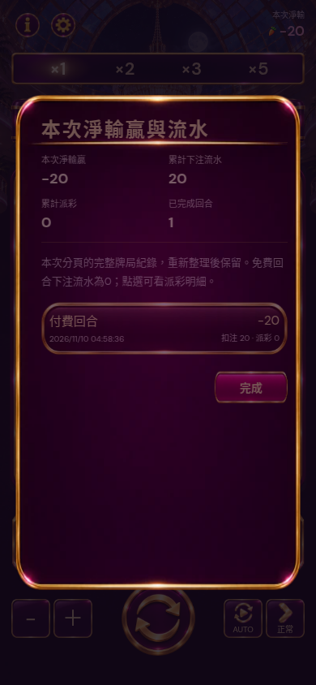

# Session ledger and speed label

Click 本次淨輸贏 to inspect this tab's round ledger, cumulative paid stakes, payouts, net change, and exact individual cascade calculations. Session history has no50-round cap; it survives reload, deduplicates settled/recovered round IDs, records free rounds with zero charged stake, and clears with the explicit reset-balance action. Recording starts with this update; earlier unrecorded rounds cannot be reconstructed. The existing cross-session recent50-round history remains separate.

Speed button now reads 正常 ↔ 快速, consistent with its actual1×/2× playback scale and original normal/fast icon assets.

Validation:30unit checks pass, including65session rounds/free-stake/reload/dedup/reset. Browser `qa/session-speed.cjs` verifies label/icon/state/animation scale, paid-round ledger, detail/back, reload persistence and mandatory manual guide entry. No math or audio behavior changed.

