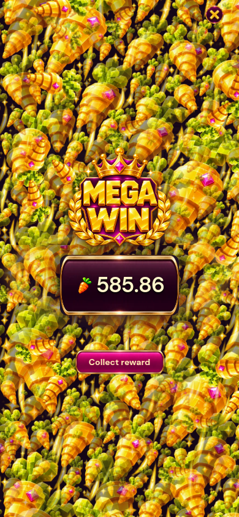

# In-game languages and full-screen carrot waterfall

Language / Wika selector on every loading guide and in Settings: 繁體中文, English, Filipino. Changes apply immediately to current UI, lessons, rules/paytable, Auto, history, labels, confirmation/countdown text and accessible labels without changing wallet, bet, result or current round. Language is remembered in this browser. Entire four lesson upper headings remain removed; mandatory entry button remains.

Independent art masters: `carrot-waterfall-sheet.png` dense transparent gold voxel carrot texture and `gold-carrot-particle.png` high-resolution gold/pink-gem carrot without text. Runtime WebP sheet640px wide and particle192px; decoded before the game is revealed. Existing art remains unchanged.

Big/Mega rewards now cover the viewport, including desktop width, with dense precomposed carrot rain. Two compositor transform sheets plus maximum36(Big)/54(Mega) larger independent gold carrots; text and controls remain above rain. Low quality retains one dense moving sheet and the existing lower particle budget (30/48). It no longer trades full-frame coverage for sparse particles. Reduced motion retains one static dense sheet, zero independent falling carrots. Closing a reward removes layers and cancels tracked animations; existing pause/resume lifecycle applies. Full reward background art is not hundreds of independent DOM particles. No math/probabilities or audio event changes.

Validation:
-30unit checks passed; engine SHA256 unchanged29c2450576a70eeede358247b26bc99c671200dac8f24deea3642513904e179e.
-`qa/locale-waterfall.cjs`:320×568 and390×844, all three languages × four lessons, entry visible/no page scroll, settings language switching, unchanged wallet, persistence after reload, full viewport waterfall, particle cap, close cleanup. Reduced-motion test keeps one dense sheet/zero falling particles.
-Visible-text sweep of Filipino rules, paytable, Auto and session history found no remaining CJK strings. English/Filipino source translations178exact entries +26dynamic patterns, plus nested accessible slide titles.
-Forced visual-quality degradation test reached low: one sheet,48Mega foreground carrots; closing leaves zero sheets. These browser checks do not establish physical-phone FPS.

