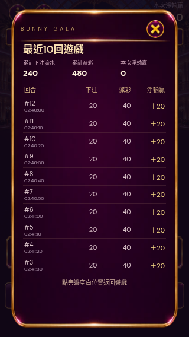

# Latest10 rounds, one-page session ledger

本次淨輸贏 opens a compact table showing only the newest10completed session rounds, newest first. All10rows are visible together; columns are round/time, charged stake, payout and net. Full-session totals remain cumulative and the stored session history is preserved. Tap the blank area outside the panel or close button to return. Three languages supported; no new imagery or animation overhead.

`qa/ledger-ten.cjs`: seeded12records, verify only newest10visible, cumulative totals still use12, all rows/footer fit without scrolling on320×568 Chinese/Filipino and390×844 English, backdrop click closes. Gameplay math/audio/rendering unchanged.

