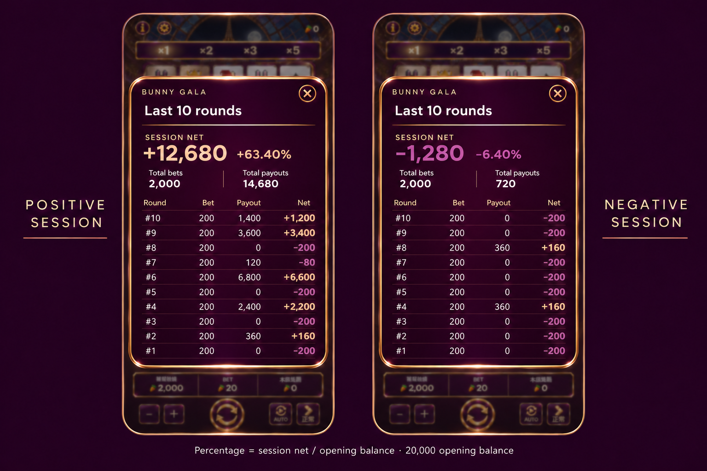

# Design proposal only: calm rewards and shareable centered ledger

No runtime changes or Site deployment in this delivery. User reports remaining gameplay stutter; prior simulated test improvements do not establish a resolved phone issue. Profiling and fixes remain required before declaring it smooth.

## Reward motion

-0–0.6s: brief low-arc toss of approximately5gold carrots for Big/8for Mega; single soft glow. Stable camera, no screen shake, no strobing or full-frame moving pattern.
-0.6–1.8s: two or three small batches settle into a carrot pile; central countup remains clear.
-1.8s+: pile stays still with a gentle highlight and sparse glints. Mega has a larger pile and the approved gold-hat rabbit peeking up. Title/number remain stationary; Collect button remains prominent and centered.
-Concept timing is visual-design guidance. Existing audio tracks should retain their authorized behavior; no new voice cues. Stop moving decorative pieces once settled; few simultaneous transforms. Actual device performance still needs validation.

## Centered ledger

-Centered content-height plum/rose-gold panel, not a full-height sheet. Frame ends immediately below row10 with small padding; no empty lower interior.
-Close X remains. Remove the outside-tap instruction. Outside tap may remain an optional dismissal; no explanatory footer is required.
-Last10rounds heading clear; decorative rule below title with adequate separation, never through letters.
-Session net is the prominent screenshot-friendly figure, with signed percentage immediately adjacent. Positive amount AND percentage rose gold #edbd9e; negative amount AND percentage purple-magenta #c866a1. Same polarity colors for table net cells and proposed game-header net.
-Percentage = session net / session opening balance ×100, formatted to2decimals; opening balance0must show an em dash rather than divide by zero. Mock opening balance20,000: +12,680→+63.40%; −1,280→−6.40%.
-Cumulative totals refer to the full session; table still shows latest10completed rounds. Existing M/B/T formatting remains required in implementation, with no number shrinking merely for large balances.
-Examples are illustrative test data, not live player earnings. Positive10-row bets total2,000, payouts14,680, net12,680; negative example bets2,000, payouts720, net−1,280.
-Background uses our current rabbit-card game. English shown for layout review; retain Chinese/English/Filipino in implementation.
