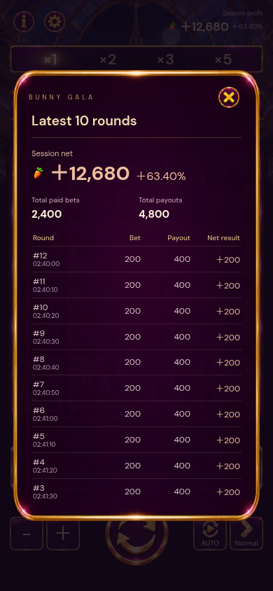

# Implemented: calm rewards and centered session result

Big/Mega:5/8brief low-arc carrot tosses and finite pile buildup; Mega's original gold-hat rabbit peeks up; two small finite glints. After approximately2.7seconds no decorative reward animations continue. Counter1800/2200ms, original reward music preserved, existing5second collection countdown remains. No waterfall canvas or scrolling texture loaded. Board/background are hidden while the opaque reward is open and restored on close. Independent heap master and clean line-free modal panel are in this folder, runtime optimized WebP93KB/87KB.

Session: centered content-height panel with last10rows, no footer hint, existing X and optional outside dismiss. Clean panel has no baked-in title separator; deliberately positioned rule remains below title. Hero signed net and signed percentage adjacent, also on game header. Positive #edbd9e, negative #c866a1. Percentage uses session opening balance,2decimals, zero opening→em dash; very large percentages retain M/B/T. Cumulative totals retained.

Reduce session-write growth: migrate old unlimited session details once into10recent records plus cumulative count/stakes/payouts. Future writes remain bounded; no wallet/result changes. Recovering same latest round does not double count. Cache number formatter reused during countups.

Verification:33unit checks, including opening ROI/zero/reset and65/100record migration/bounded journal/dedup. Browser `qa/calm-rewards-ledger.cjs`:320×568 Chinese,390×844 English/Filipino;10rows/content fit/no bottom void/percentage/sign/close/class cleanup; Big/Mega no canvas or old texture; finite effects settled; board restored. `qa/smooth-assets.cjs`: retry/no charge on asset failure, no blank visible cards at DPR3/no new image downloads across6cascades, payout2148, audio failure nonblocking. `qa/loading-guide.cjs`: four decoded lessons and mandatory first/return entry retained.

Performance: attached comparison reports use identical seed37, Filipino, DPR3 and4×CPU slowdown. Multiple runs fluctuate: p95~16.8ms, occasional>50ms frames remain. Early new version had5/8post-reward long frames versus one old run4; after bounded journal/cached formatter final new run3, reward1 in both corresponding final runs. No measured blank cards; payout2148. Old reward retained one canvas; new reward has zero ongoing decorative animations after settling. These measurements support lower persistent reward work, NOT a claim that all phone stutter was caused by the waterfall or is fully resolved. Further real-device reproduction remains needed if reported stutter persists.

Engine SHA256 unchanged29c2450576a70eeede358247b26bc99c671200dac8f24deea3642513904e179e.

