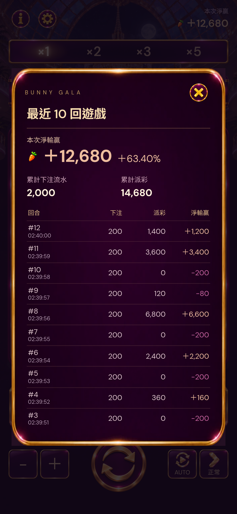
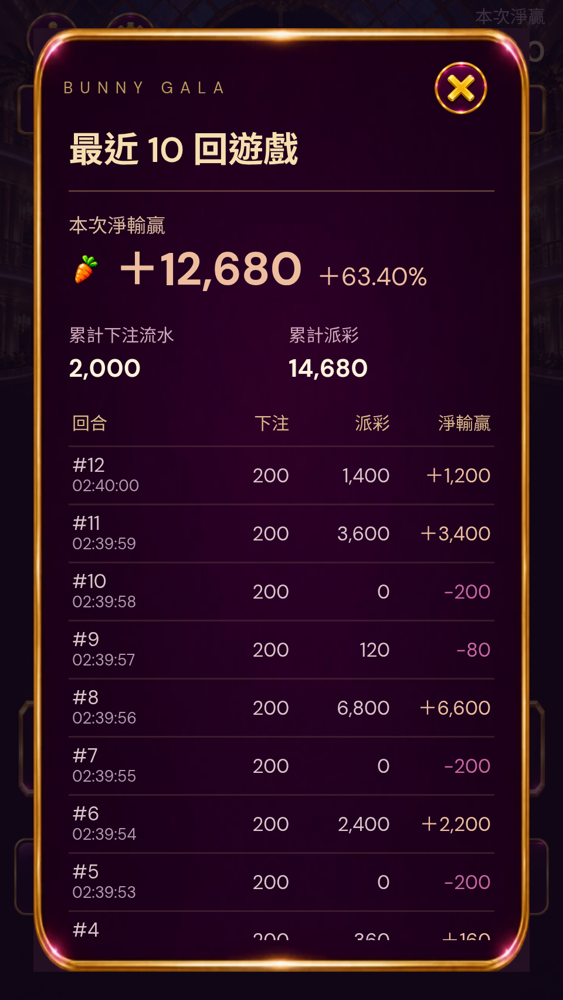

# Restore the centered ledger and native scrolling

2026-11-11. Restore only the previous content-height centered ledger design: latest10rounds, session net with percentage relative to session opening balance, rose-gold positive/purple-magenta negative values, independent line-free frame, close X and no footer hint. Modal height is max-content capped to viewport, so no empty full-screen lower section. Insufficient height scrolls the content only; the header/X stays fixed.

Root scrolling defect: legacy history was given the free-spin `rabbit-feature` class; its stylesheet sets modal content overflow:hidden. Remove that class from history, and use an independent session-ledger class with overflow-y:auto, min-height:0, touch-action:pan-y and -webkit-overflow-scrolling:touch. Clear it before another modal opens.

Read-only merge of current baseline session history and stored newer session-v2 records keeps prior totals/records, deduplicating known round IDs. No change to round settlement, storage writes, RNG, card rendering/decoding, audio or paused language/reward features. The panel art is decoded on first requested open, not added to the normal gameplay preload loop.

Verification: `qa/restored-ledger-scroll.cjs`320×568 touch swipe actually changes scrollTop;390×844win/loss examples fit all10without scrolling. Panel centered/content-fit, bottom padding only, signed ROI correct, close visible, wallet unchanged, old history scrollable, prior/current session merge totals checked. `qa/baseline-card-stress.cjs`5normal rounds/multiple cascades still shows20cards each, no recovery guard, expected final2740. Physical iPhone confirmation is not claimed by these Chromium touch simulations.

