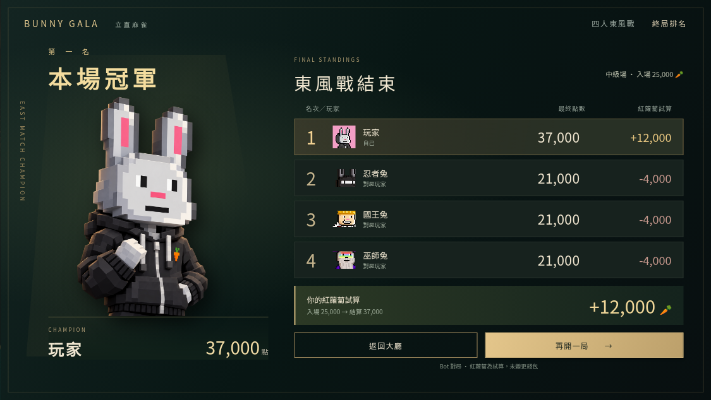
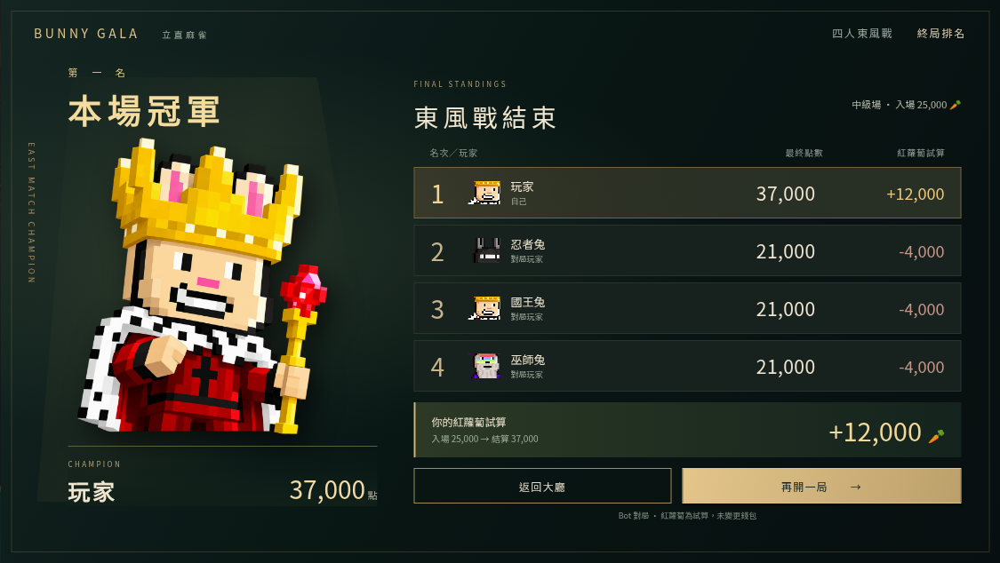
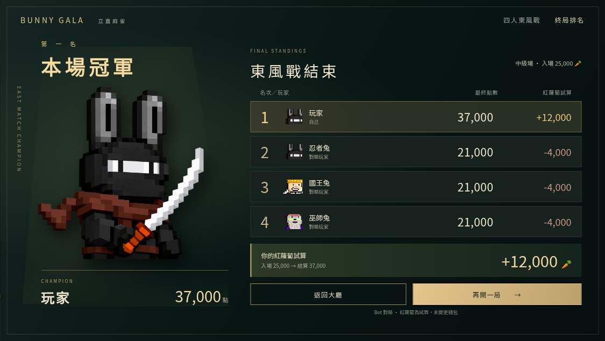
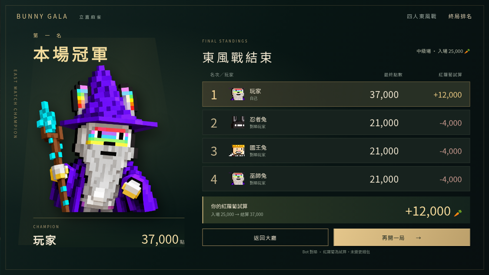

# 終局排名 · 四角色可切換設計預覽

[開啟可操作預覽](https://bunny-gala-table-demo.almondcrab34.chatgpt.site/art/final-ranking-v2/index.html)

左側以既有去背角色圖展示第一名，角色選擇同步更新冠軍名稱、頭像與排名角色排列。右側展示四家最終點數、紅蘿蔔增減、返回及再開按鈕。預覽數字是示例，不連接錢包。此設計已接入實際終局排名，使用本場真實分數及冠軍角色；Bot 紅蘿蔔標示為試算。

| 黑帽T兔 | 國王兔 |
| --- | --- |
|  |  |
| 忍者兔 | 巫師兔 |
|  |  |

去背角色來源：`hoodie-character.png`（重新製作、與另外三隻統一風格的黑帽T兔） 及 `/art/ribbon-v2/{king,ninja,wizard}-character.png`，均為帶透明 Alpha 的既有角色素材。直接使用角色圖，沒有在背景圖中烙印冠軍，便於按真實第一名替換。

本次替換終局設計預覽中的第一位角色及其排名頭像；黑帽T兔原始去背圖見 [hoodie-character.png](hoodie-character.png)。其他三角色原圖沿用。內部 `yellow` 預覽選項保留相容舊連結，顯示名稱與素材已換新。

## 實際遊戲終局截圖

DEMO 選擇「終局排名 · 實際遊戲版面」可直接測試。以下由真實結算元件截取：

| 黑帽T兔 | 國王兔 |
| --- | --- |
|  |  |
| 忍者兔 | 巫師兔 |
|  |  |
