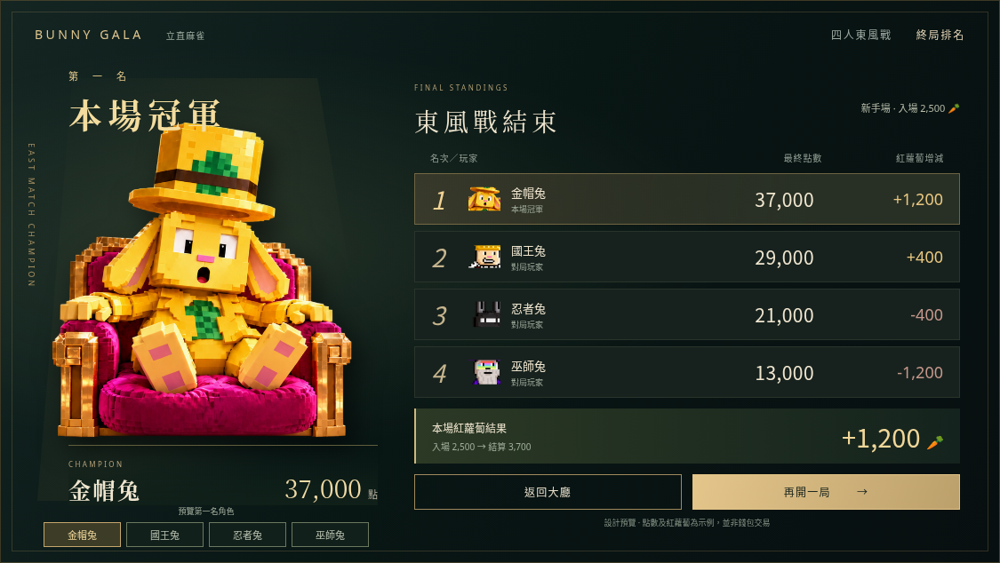
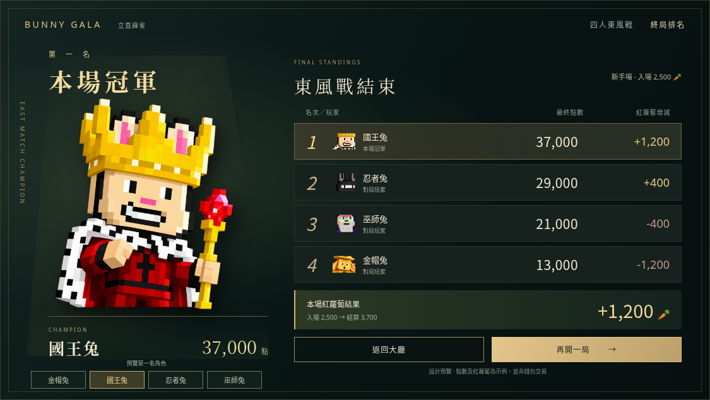
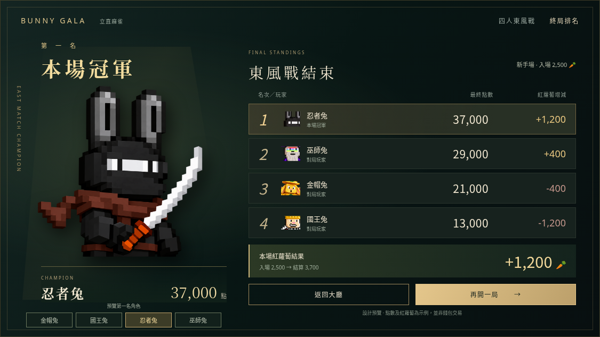
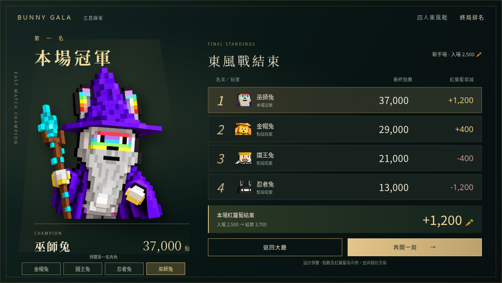

# 終局排名 · 四角色可切換設計預覽

[開啟可操作預覽](https://bunny-gala-table-demo.almondcrab34.chatgpt.site/art/final-ranking-v2/index.html)

左側以既有去背角色圖展示第一名，角色選擇同步更新冠軍名稱、頭像與排名角色排列。右側展示四家最終點數、紅蘿蔔增減、返回及再開按鈕。預覽數字是示例，不連接錢包。正式對局的終局頁尚未替換，待設計確認。

| 金帽兔 | 國王兔 |
| --- | --- |
|  |  |
| 忍者兔 | 巫師兔 |
|  |  |

去背角色來源：`/art/results/yellow-presentation.png` 及 `/art/ribbon-v2/{king,ninja,wizard}-character.png`，均為帶透明 Alpha 的既有角色素材。直接使用角色圖，沒有在背景圖中烙印冠軍，便於按真實第一名替換。
