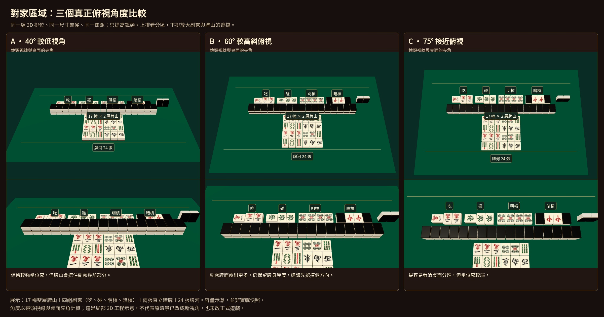

# 對家四組副露：角度比較

先看同一場景的三個角度，再決定整張賭枱的正式視角。這次是對家區域的局部 3D 工程示意，並沒有更換遊戲賭枱或背景美術。

- [A：40°，較低視角](A-40-degrees.jpg)。較強坐位感，但副露靠前部分會被牌山遮擋。
- [B：60°，較高斜俯視](B-60-degrees.jpg)。副露較清楚，亦保留麻雀厚度；建議先以這個方向討論。
- [C：75°，接近俯視](C-75-degrees.jpg)。更容易看清桌面，但坐位感較弱。

每個角度的上排顯示對家分區，下排放大牌山及副露。角度是鏡頭視線與桌面的夾角；例如 90° 是垂直俯視。A 是低角度比較例，並非宣稱現有遊戲就是精確的 40°。

三種角度使用完全相同的模型尺寸、排位及焦距，只改鏡頭高度方向。對家區域包含：17 幢雙層牌山、四組副露（吃、碰、明槓、暗槓）、兩張直立暗牌、24 張牌河。這是容量示意，並非同一副 136 張牌的實戰快照。牌面沿用已認可的遊戲圖集。

為了快速比較遮擋，只渲染綠色桌面區域，沒有重繪整張賭枱、角色或金邊，也沒有改動正式遊戲。選定方向後，仍需將原有賭枱背景、完整四家排位和角色按同一視角一起校準。

[渲染參數](camera-checks.json) · [重製程式](model/render.mjs)
