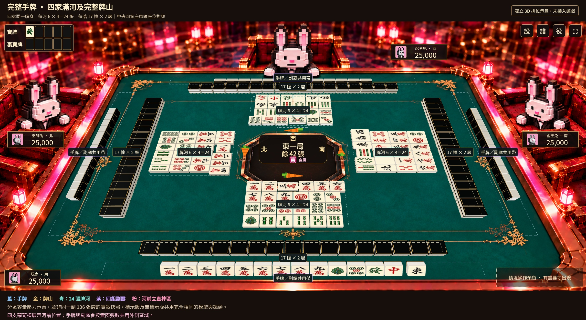
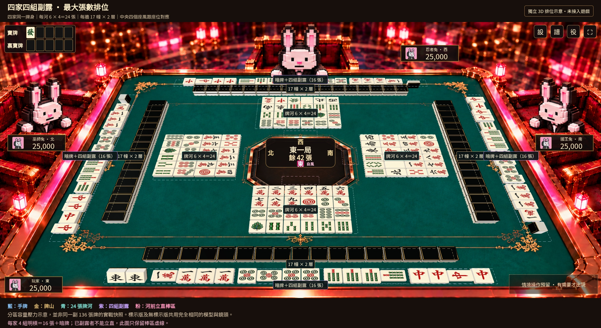

# 滿版牌枱：四家座風、蘿蔔棒及完整容量

保留上一版認可的滿版桌面及三個半身角色。這次改用可逐隻計數的 3D 模型檢查區域，並非直接生成一張「看起來放得下」的圖。尚未改動正式遊戲。

## 1. 完整手牌＋完整牌山＋四家 24 張牌河

- 每邊牌山 **17 幢 × 2 層＝34 張**，上下層相接，對家與玩家同軸，左右兩家轉 90°。
- 每家牌河 **6 張 × 4 行＝24 張**，保留立直宣言牌的橫放間距。
- 玩家 14 張手牌、三家各 13 張暗牌；三家牌面不揭露。
- 使用現有橙／綠實色 voxel 蘿蔔立直棒，放在牌河前方、朝向桌心。
- 中央顯示局目、剩餘張數，以及四邊座風；本例下東、右南、對家西、左北，自己的東以粉紅標示。正式接入時會按當局莊家及玩家座位更新，並非固定當玩家永遠是東。

[無標示版：看實際排位及蘿蔔棒](full-hands-clean.jpg)

## 2. 每家四組副露：以四組明槓測最寬上限

每家實際擺出 **4 組 × 4 張＝16 張副露**，並預留橫放叫牌張的寬度；不是只擺四組碰牌、少算了四張。玩家保留兩張暗牌，其餘各一張。

已副露者不能立直，因此這張不擺蘿蔔棒，只用粉紅虛線保留同一區域。吃、碰及加槓的水平占位不會超過這個四組明槓上限；暗槓仍保留覆牌，加槓仍按三張底牌加一張疊上處理，不能畫成五張。

[無標示版：四家各 16 張副露](four-kans-clean.jpg)

**以上是各區域同時擺滿的壓力示意，不是同一副 136 張牌的實戰快照。中央「餘 42 張」只沿用資訊顯示樣式。**

## 這次補齊與保留的元素

| 元素 | 排位及處理 |
| --- | --- |
| 桌面與角色 | 保留大桌面，三個角色留在枱沿外側，不讓完整身體／座椅擠走麻雀空間。 |
| 牌身 | 手牌、牌河、暗牌、牌山及副露共用 100 × 136 × 64 的同一模型；未獨立縮放某一家。 |
| 牌面與金邊 | 沿用已認可的牌面圖集、孔雀一索、圓角牌身、黑金牌背及連續金邊。 |
| 牌大小 | 相對上一張概念圖稍收細，騰出最大牌河及完整牌山的間距；不縮小桌面佔比。 |
| 中央資訊 | 四個座風環繞局目及剩餘牌數，自己的座風另作顏色提示；不加回多餘的 0。 |
| 立直棒 | 蘿蔔棒位於河前，避開中央資訊及牌面；副露情境只顯示預留區。 |
| 玩家資訊 | 四家名稱、座風、分數及頭像位置。頭像先用現有佔位圖，Bunny Gala 帳戶頭像仍留待接通。 |
| 寶牌／裏寶牌 | 各五格；揭示牌及背面格使用同一比例。 |
| 選單 | 保留設定、牌譜、役種及全螢幕入口；牌譜不假裝已完成歷史功能。 |
| 情境操作 | 標示版右下留有操作空間；立直、吃、碰、槓、和牌、過等只在需要時出現，不長期塞滿桌面。 |
| 操作與動態 | 點牌直接出牌、整面亮起的提示、立直候補、立直後摸切、上層先摸及結果理牌等既有要求保留；這輪是靜態排位示意，未修改操作邏輯。 |

## 檢查結果

四張圖由同一份模型程式在 Chromium 實際渲染；標示版及乾淨版共用完全相同的鏡頭和座標。

- 逐隻核對各家牌數、兩層牌山、24 張牌河及 16 張副露。
- 實際模型邊界全部在桌面內，沒有牌身交疊，牌底接觸桌面；牌山上層直接疊在下層。
- 每張公開牌面取九個點，檢查是否被其他牌身或牌山遮住，四家均通過。
- 中央資訊不遮住牌面或蘿蔔棒；玩家資訊、寶牌欄、選單及操作預留區不遮住公開牌面。

滿版桌面使用遊戲構圖投影，不再把它稱作真正 60°。這輪先核對容量與區域，手牌的最終操作視角及材質觀感會隨選定構圖再校準。

[逐項數據](checks.json) · [重製程式](model/render.mjs)
