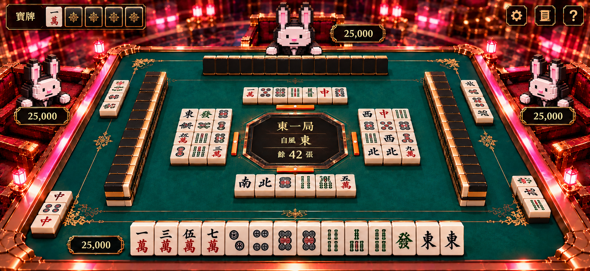

# 滿版牌枱＋三個半身角色：構圖預覽

這張先用來決定畫面方向，尚未修改遊戲。

- 以雀魂式的牌桌佈局作參考，保留 Bunny Gala 的綠色金邊、黑金麻雀及兔仔美術。
- 桌面接近滿版，賭場背景及座椅退到窄邊。
- 三個角色以一致的頭部視覺尺寸配置，只保留上半身，避免完整角色佔去麻雀空間。
- 手牌、牌河及副露優先保持清晰；不再硬套真正 60° 的物理構圖。

生成概念圖用於審閱構圖；牌面內容及擺位仍需在選定方向後，以實際遊戲資料及模型校準。
