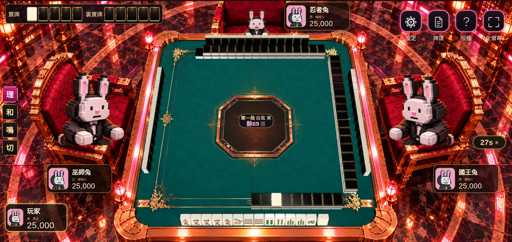
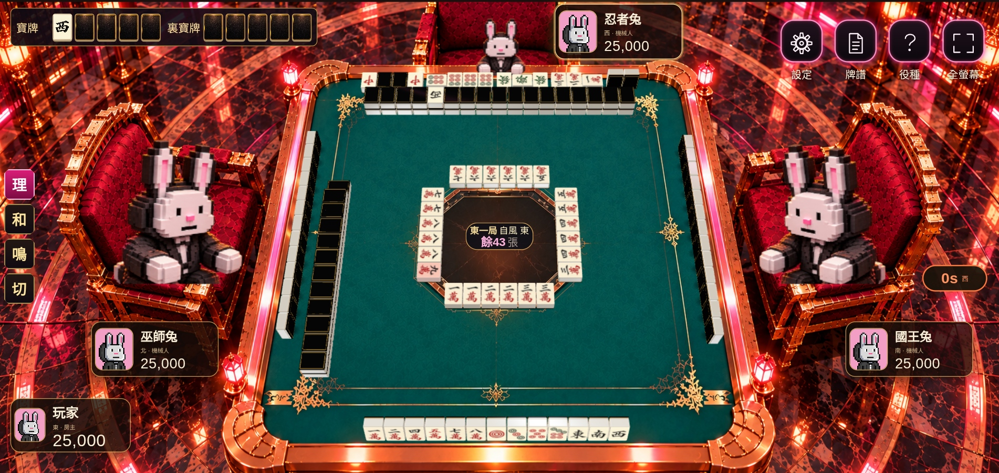
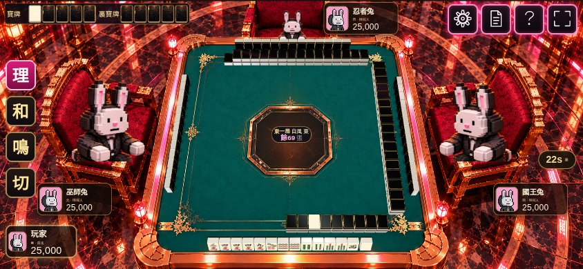
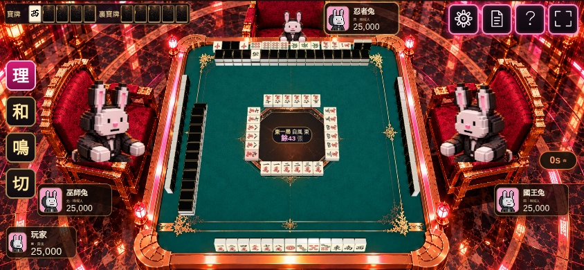
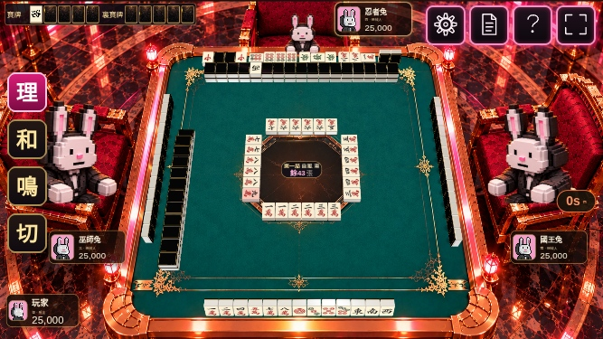
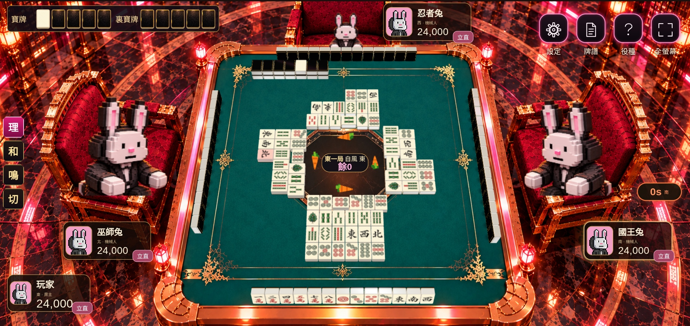

# 真正 60°：已接入完整遊戲

這次已修改實際遊戲，圖片由 Chromium 開啟真實 client／server 後截取。保留原款綠色花紋、金邊、中央八角區及紅櫈，背景與麻雀使用同一套真正 60° 攝影機投影。

## 電腦：一般對局



## 電腦：對家四組副露，前方仍有完整牌山

吃、碰、明槓及暗槓維持同一行，前方是 17 幢完整雙層牌山；頭像分數卡亦移離牌面。



這是開發用排位情境，由同一副 136 張實體牌分配，並非自然打到此時的牌譜。

## 電話橫屏







另外也檢查了[右家四組](phone-right-four-melds.jpg)、[左家四組](phone-left-four-melds.jpg)及[自己四組](phone-own-four-melds.jpg)，不是只修對家。

## 牌河及實色立直棒



此圖為排位檢查情境，立直標記及牌河分配用於檢查四個方向的可見度，不代表合法立直牌譜。

## 這次完成的項目

- 真正 60° 共用攝影機。已用獨立 Three.js PerspectiveCamera 比對 CSS 及 WebGL 的投影，沒有沿用舊背景的「高度參數」冒充實際角度。
- 四家共用 100 × 136 × 64 同一款牌身；牌山、副露及最多四行牌河分開留位。桌面座標為 2500 × 2500，不再按副露事件縮放鏡頭。
- 三家暗牌維持直立、朝向各自持牌者。自己手牌只作 15° 物理後傾，以便在高角度閱讀，尺寸不變，最低角接觸桌面。
- 副露禁止換行，吃碰的橫牌預留額外寬度；明槓、暗槓、加槓仍沿用實際遊戲資料。
- 金邊改為連續圓角金屬接縫，並加上牌背金色嵌邊；不是只畫一條幼線。保留已認可的牌面及孔雀一索。
- 蘿蔔立直棒使用不受場景燈光漂白的橙／綠實色材質；位置仍在牌河前方、靠桌心，避開中央局目欄。
- 寶牌及裏寶牌各留五格，已揭示牌與背面槽統一為 100:136 比例，電腦及電話均有指定尺寸。
- 角色沿用現有兔仔圖片，按紅櫈椅面重新定位，座面以下裁去並配合桌面深度遮擋；不是新增完整角色骨架。

## 驗證

- `npm run build`：engine、server、client 構建通過。
- `npm run typecheck`：全工程型別檢查通過。
- Server 的 v270／viewport 測試：43 項通過，包含新增四組副露情境的 136 張實體牌及私隱序列化。
- `scripts/browser-table-60.mjs`：電腦 1902×900、電話 844×390／667×375；對家完整雙層牌山及四組副露，每張公開牌面九點可見度檢查通過，頭像等介面不遮住牌面。另檢查其餘三家的四組副露。
- 既有 browser table UI、tile art、felt、viewport 檢查通過：點牌出牌、重連、全部叫牌類型、38 個役種示例牌、固定鏡頭、四個手機尺寸、接地、穩定牌河及立直棒可見度。
- `npm run verify:art`：原有鎖定美術保留，新背景雜湊檢查通過。

[實際渲染檢查數據](checks.json) · [新視角空枱背景](../../../client/public/art/gala-table-60-empty.png)

## 在現有 Codespaces 更新

在存放 repository 的終端機執行：

```bash
cd /workspaces/BWJMH
git fetch origin
git switch codex/clear-table-scene
git pull --ff-only
cd Bunny_Gala_Riichi_v2.7.2
npm run build
```

然後重新啟動目前的 client，沿用已成功連線的同源代理設定；server 程式沒有這次畫面改動。瀏覽器重新整理即可，不需要重新開房。不要同時再開第二個佔用同一連接埠的服務。
