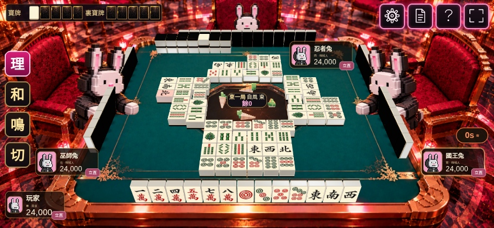
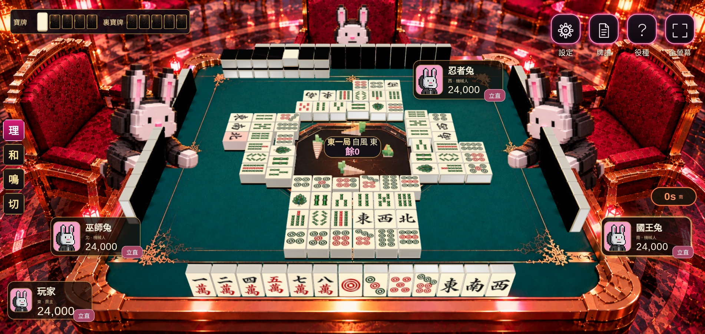

# 已接入遊戲的麻雀材質及立直棒 V3

這一版為實際 React／WebGL 遊戲截圖，並非另做的場景示意圖。

## 電話版

[較小電話 667 × 375](phone-667x375.jpg) · [915 × 412](phone-915x412.jpg)

## 桌面版

## 已接入的改動

- 全部 37 款牌面，包括孔雀一索及三款赤五，已由正式牌面資源載入。
- 全枱共用一款實體麻雀模型：象牙白圓角牌身、黑色背層及幼金接縫；手牌、牌河、副露及牌山尺寸一致。
- 牌面保留琺瑯圖案的光澤，但不接受會洗白圖案的強烈場景反光；牌身邊緣及牌背仍接受燈光。
- 四家立直棒均在各家牌河前方、靠枱心一側，並留出實體及鏡頭上的空隙。棒由真實立直狀態觸發。
- 牌河由靠枱心第一行向自己方向增加，每行六張，預留四行二十四張；新增一行時，前面已打出的牌不會移位。
- 橫放立直宣言牌另有寬度預留；兩層牌山上下接觸。中央局目、自風及餘牌資訊避開牌面及立直棒。
- 役種及結算畫面共用同一套牌面。

[役種實際畫面](live-yaku-art.jpg) · [結算實際畫面](live-result-art.jpg) · [視窗及位置檢查摘要](checks-summary.json)

截圖使用瀏覽器測試牌局，刻意展示四家立直及一個二十四張牌河，供核對材質和遮擋。它是顯示測試資料，不代表四家手牌均符合實際立直條件。

## 驗證

`scripts/browser-tile-art.mjs` 檢查桌面與三種手機橫向尺寸：實際貼圖載入、二十四張牌河、第一行固定位置、立直棒在河前、棒身與牌河／中央資訊的遮擋、牌山層高、役種及結算牌面。

另外執行現有 `browser-felt.mjs`、`browser-table-viewport.mjs`、`browser-table-ui.mjs`，檢查接地、畫面邊界、原賭枱、吃碰槓、直接出牌及鏡頭穩定。

原本賭枱、角色及鎖定素材保留；正式牌面資源在 [`client/public/art/tiles`](../../../client/public/art/tiles)。
