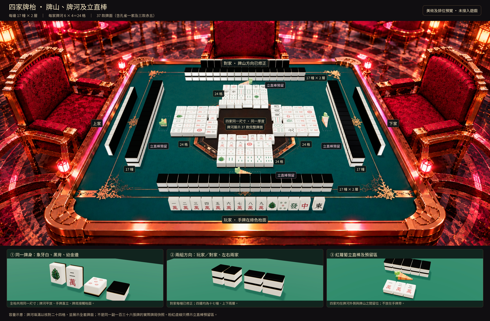
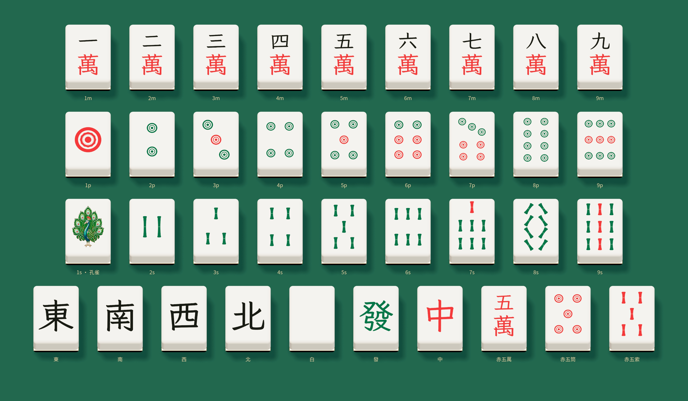
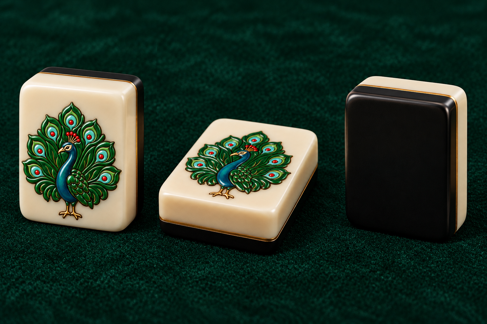
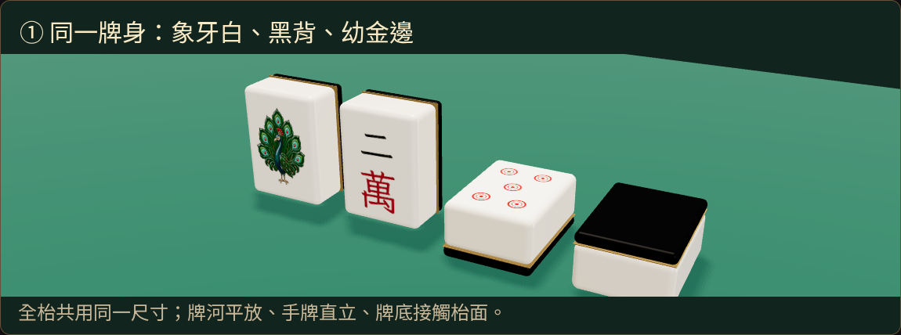

# 四家牌枱完整示意 V2

本輪按用戶要求補上孔雀一索，重新整理四家牌山、二十四張牌河、立直棒及預留區。沿用原本綠色花紋賭枱、金銅圓邊及紅絨椅，未修改遊戲。

## 完整牌枱

[開啟完整尺寸圖片](table-complete-preview.jpg)

- 四邊各 **17 幢、每幢 2 層，共 34 張**。
- 玩家與對家每幢長邊方向相同；左右兩家轉九十度。不沿用上一版錯誤的對家方向。
- 四家牌河各 **6 張一行、4 行，共 24 張**，同一個麻雀模型、同一厚度，依座位轉向。
- 每家第一行第三張橫放，示意立直宣言牌。橫牌增加的寬度另有預留，後面的牌順延，不互相重疊。
- 四家立直棒統一留在 **牌河靠自己的一側、牌山與牌河之間**，不放在手牌旁。粉紅虛線表示預留空間，實際紅蘿蔔棒已放在格內；虛線不是遊戲操作按鈕。
- 玩家手牌直立在綠色枱面；摸牌與原手牌稍分開。枱框上沒有放牌。
- 牌山、牌河、手牌及立直棒的預留範圍已檢查沒有互相重疊。所有牌底接觸枱面或下一層牌頂。

**這是滿容量擺位示意，不是真實對局快照。** 同時放滿四邊牌山、四家牌河及手牌，是為檢查所需空間；牌河也用來展示全套牌面。重複出現的牌與示意手牌不代表一副 136 張牌的合法分配或立直聽牌狀態。

## 全部 37 款牌面

[開啟 37 款近鏡總覽](all-37-tiles-preview.jpg)

前面三行分別為一至九萬、一至九筒、一至九索；最後一行為東、南、西、北、白、發、中及赤五萬、赤五筒、赤五索。

孔雀一索已按本輪授權重新設計，不再等待舊稿。二索是兩條完整長索，八索是八條斜索；筒子及索子的數量均逐款核對。赤五沿用普通五的排列，圖案改為紅色。白板留白。

象牙白圓角牌身、黑色背層、幼金接縫由同一模型構成；牌面採紅、黑、綠色。平放牌面已降低反光，避免字與花紋被高光洗白。

## 材質及孔雀一索近鏡

上圖為生成的材質參考，沿用先前認可的象牙白、黑背及幼金邊；下圖為排位模型的實際近鏡。材質參考供確認最終外觀，模型圖用於核對尺寸、方向及接觸位置。

[孔雀一索透明原圖](peacock-1s-emblem.png)

## 驗證及接入狀態

[數量、方向、接地、牌面圖案數量及預留區檢查](geometry-checks.json)。預覽使用同一個 88 × 120 × 56 模型單位的麻雀，不以各家不同縮放去拼出畫面；遠近大小由同一鏡頭決定。

這份預覽及孔雀原圖均放在 `docs`，遊戲不載入。先確認本輪圖片，再接入遊戲；現有對局、賭枱、鏡頭及操作未變更。

獨立來源在 [model](model)。於專案根目錄執行 `node docs/art-previews/table-design-v2/model/render.mjs` 可重新輸出；需要已安裝專案依賴及 Chromium。輸出預設在 `/tmp/bunny-table-design-v2`，可用 `QA_OUTPUT_DIR` 指定目錄。
