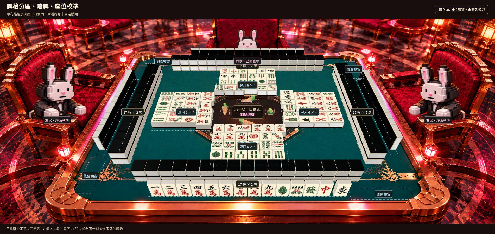
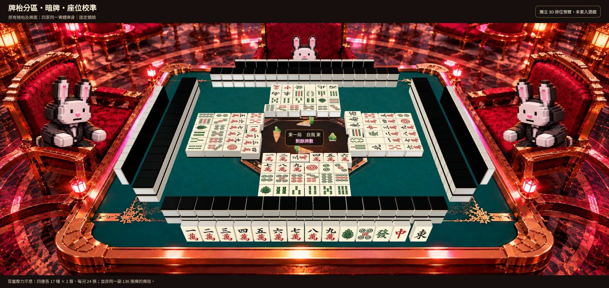
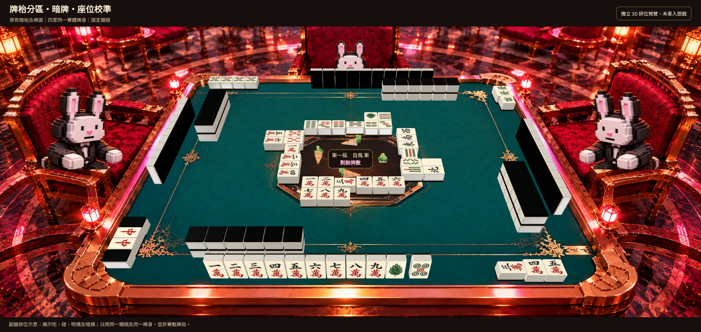
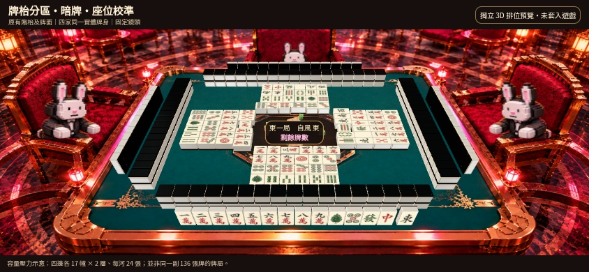
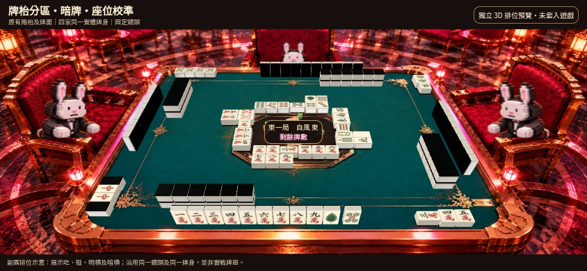

# 牌枱分區、暗牌及座位校準預覽

這一輪只提供排位預覽，尚未修改正式遊戲。所有圖片沿用現有賭枱、角色及已認可的麻雀牌面，沒有重新繪製美術。

## 1. 分區標示：擺滿之後是否仍然夠位

每邊 17 幢雙層牌山、每家 24 張棄牌（6 × 4），另留暗牌、副露及河前立直棒空間。分區虛線只在這張審閱圖出現。

## 2. 同一畫面，隱藏標示

四家共用同一尺寸的牌身，牌底落在綠色桌面。對家牌山與玩家牌山同軸，左右兩家轉 90 度。暗牌面朝持牌者，沒有揭露對手牌面。

容量圖同時擺滿牌山及牌河，是為了檢查最佔空間的各個區域，並非同一副 136 張牌的實戰快照。

## 3. 牌山減少、有人副露之後

展示吃、碰、明槓及暗槓，讓三家暗牌擺位更容易檢查。與上一張使用相同鏡頭及牌身；不因副露而放大縮細。這也是排位示意，並非可重播的實戰牌局。

## 4. 電話橫屏

## 本輪調整及限制

- 保留同一張賭枱背景，桌面邊界不變。桌面模型由 2200 調至 2700 單位，單隻麻雀仍為 100 × 136 × 64；等同增加桌面相對於麻雀的可用空間，四家一併調整，沒有獨立壓扁某家暗牌。
- 鏡頭高度投影由 52° 改為 59°，用於檢查立起的牌身外觀。平面桌面仍對準同一張背景的四角，並非宣稱已將背景換成新的高空視角。
- 手牋牌底距桌心 1265、牌山中心距桌心 1050；牌河內緣距桌心 340。立直棒仍在牌河前方、朝桌心預留。
- 角色沿用現有透明圖，以原背景椅面作位置基準，只顯示座面以上部分，再配合桌面深度遮擋。這是現有圖片的排位／遮擋校準，不是新增完整角色骨架或坐下動畫。
- 本輪沒有改金邊材質、立直棒配色、寶牌欄或其他操作介面；圖中也未疊上正式遊戲的頭像卡及功能按鈕。這些項目仍需各自檢查。

## 已檢查

用 Chromium 實際渲染電腦 1902 × 900 及電話 844 × 390，共五個畫面，並檢查每一隻牌的實際模型邊界：

- 完整容量每河 24 張，每牆 17 幢、34 張；手牌為玩家 14 張、其他家各 13 張。
- 全場牌身同一尺寸，桌面牌接地；牌山上下層相接。
- 各牌身沒有互相穿插，全部牌身位於綠色桌面範圍內。
- 對手暗牌正面朝外，沒有朝向桌心洩露手牌。

[模型數據及檢查結果](geometry-checks.json) · [可重製的渲染程式](model/render.mjs)
