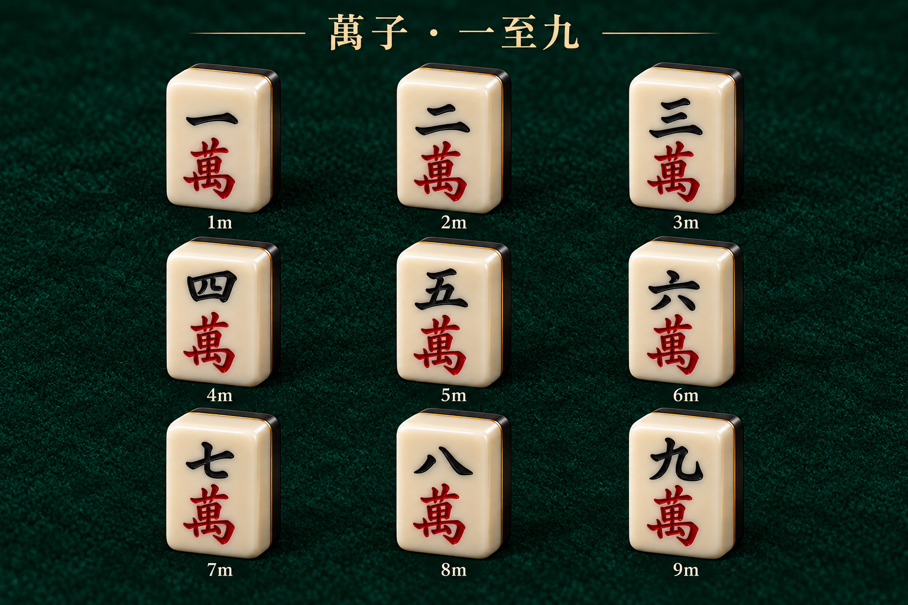
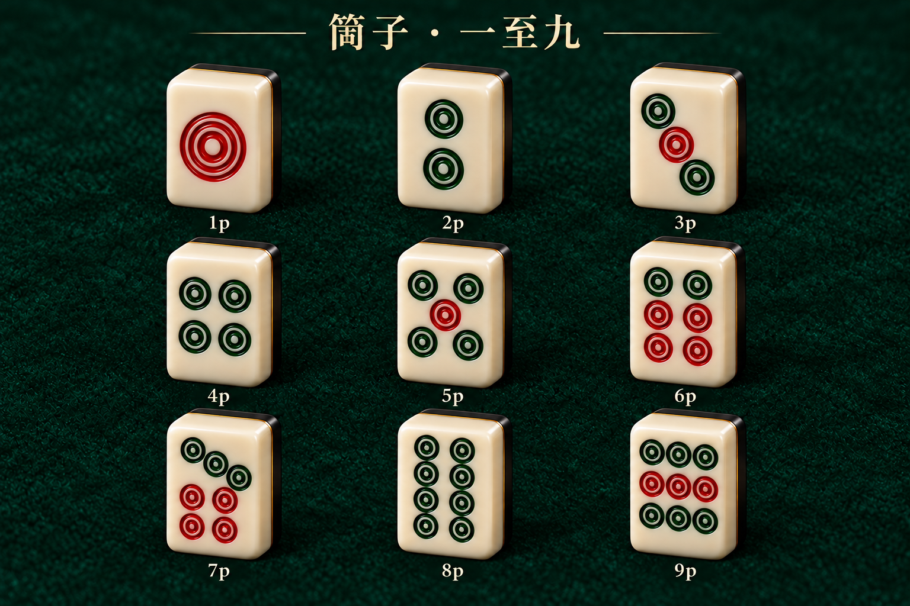
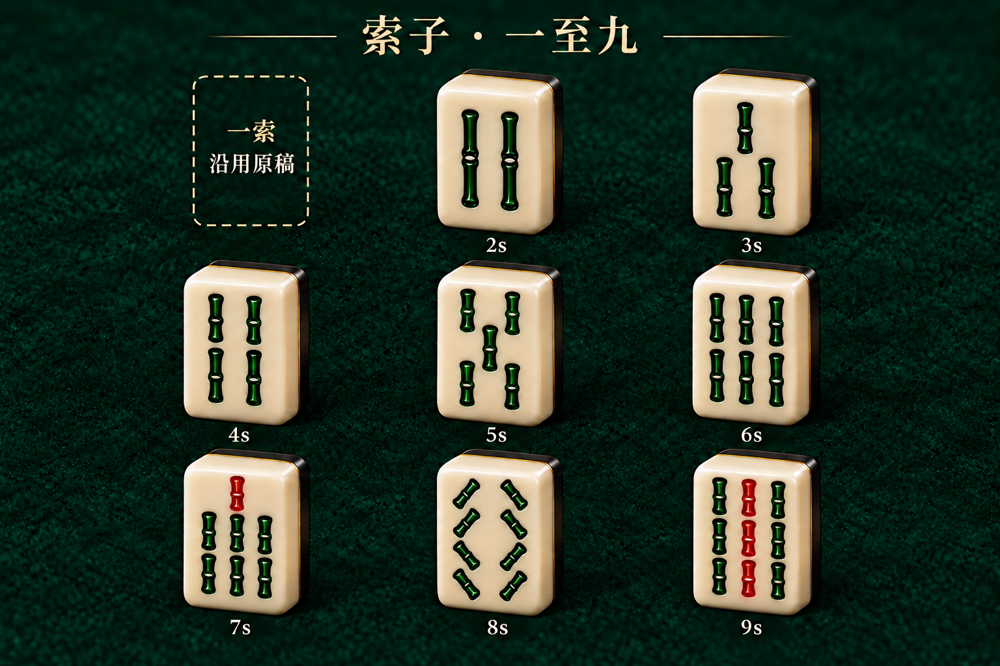
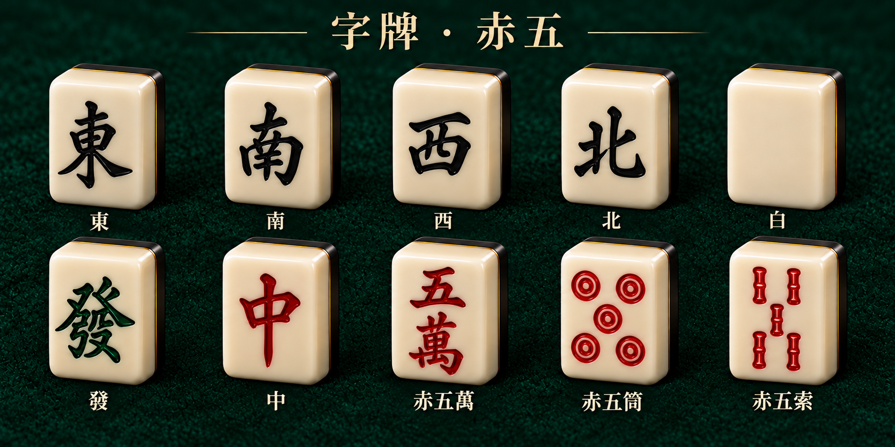
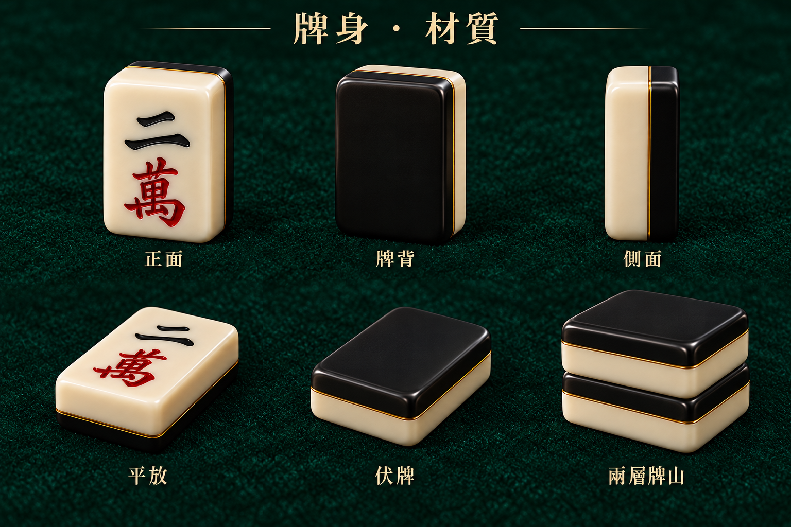

# 全套麻雀質感及牌面預覽 V1

沿用先前認可的象牙白圓角樹脂牌身、黑色牌背、幼金接縫，以及紅／黑／綠色亮面雕刻風格。這一版只供美術確認，未接入遊戲。

目標是 **34 種基本牌面 + 3 種赤五，共 37 款**。現已完成 **36 款預覽**；一索保留用戶原稿的位置，待重新提供原圖後補齊，不會以通用鳥牌或新圖代替。

## 萬子：一至九

黑色數字、紅色「萬」。赤五萬另外收在字牌及赤五圖。

## 筒子：一至九

逐張核對點數。一筒為紅色同心圓；二、四、八筒用綠色；其餘依圖分配紅綠。

## 索子：二至九；一索沿用原稿

二索為兩條完整長索；八索為八條斜索。左上虛線格只表示等待一索原圖，不是新牌面。

## 字牌及三款赤五

上排：東、南、西、北、白。下排：發、中、赤五萬、赤五筒、赤五索。白板保持空白；發用繁體字。赤五的數字或圖案改為紅色，牌身一致。

## 牌身、牌背及厚度質感

正面、牌背、側面、平放、伏牌及兩層牌山。這是材質與外形示意；生成圖的透視及厚度不可直接當成模型量尺。接入時要由同一個 3D 模型負責所有座位、手牌、牌河、副露及牌山，統一尺寸及層次。

## 接入狀態

- 所有圖片均為待確認的美術參考，保留在 `docs`，遊戲不載入本資料夾。
- 未更改現有賭枱、鏡頭、角色、牌河、牌山、立直棒或操作。
- 一索待用戶原稿；其他 36 款已提供設計預覽，並非已匯出的獨立牌面貼圖或可直接使用的材質包。
- 用戶確認後，再製作與遊戲牌種資料對應的獨立牌面貼圖及材質；牌面光影交由統一模型和場景燈光處理，不把預覽圖的背景、透視及陰影烘焙進遊戲牌面。

[牌種、圖上位置及待辦對照表](tile-manifest.json)
