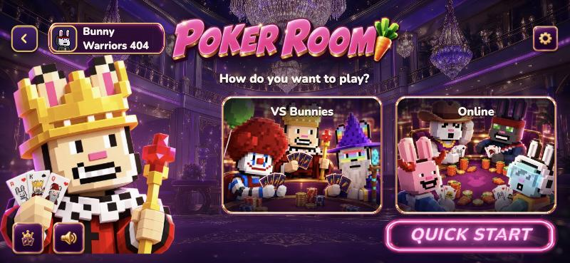
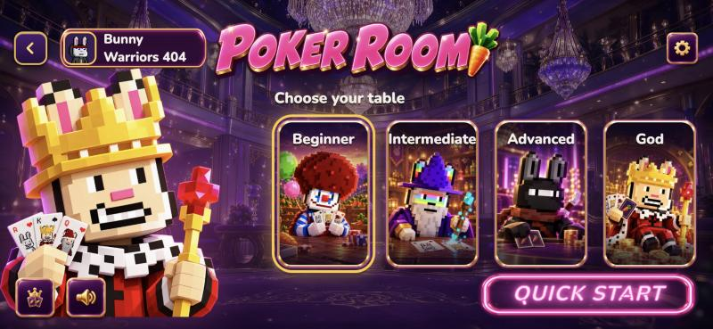

# 大廳規格（標準：德州撲克 Poker Room）

每款 Bunny Gala 遊戲的大廳都用同一個版面，照德州撲克（Poker Room）的大廳做。玩家從這款換到那款，按鈕都在同一個位置。

**做法：不要自己做大廳。** 範本 `games/_template` 已經附好標準大廳：
- `web/lobby/lobby.ts`、`web/lobby/lobby.css`：版面和程式，每款都一樣，**不要改**。
- `web/lobby.ts`：只填設定（`mountLobby({...})`）。
- `web/public/assets/lobby/`：換成你的圖。

## 對照：Poker Room 的大廳（812×375）

第一步：怎麼玩



第二步：選房間



## 版面

以橫屏 **812×375** 為基準。外框留白：上 10px、左右 16px、下 12px，再加上手機的安全區域。版面分成兩欄（左 38%、右 62%）和三列（頂列、內容、底列）：

```
┌──────────────────────────────────────────────────────────────┐
│ [←][名牌：頭像 名字 🥕餘額]        [ LOGO ]              [⚙] │  頂列，至少 44px 高
│                                                              │
│   主視覺角色          怎麼玩？ / 選擇房間                     │
│   （左下，             ┌────┐┌────┐┌────┐┌────┐             │  內容
│    最高到名牌下面）    │卡片││卡片││卡片││卡片│             │
│                        └────┘└────┘└────┘└────┘             │
│ [規則][音效]                              (( QUICK START ))  │  底列
└──────────────────────────────────────────────────────────────┘
```

| 元素 | 位置與尺寸 | 行為 |
|---|---|---|
| 返回鍵 | 頂列最左，38×38，平台共用的金色方鍵 | 選房間時回到「怎麼玩」；在「怎麼玩」時回 Bunny Gala 首頁 |
| 玩家名牌 | 返回鍵右邊（左邊空 50px），名牌底圖 `icon-player-plate.png`；38px 頭像、名字（15px 粗體，太長變 …）、餘額（12px 金色） | 只顯示 |
| Logo | 頂列正中間，高度 `clamp(60px, 24vh, 112px)` | 只顯示 |
| 設定 | 頂列最右，38×38 金框圖示 | 打開設定面板：音樂、音效兩個開關 |
| 主視覺角色 | 左下貼齊底邊，高度 = 畫面高 − 64px（頭頂不碰名牌），最寬 44vw | 只顯示，不擋點擊 |
| 標題 | 右欄卡片上方，`clamp(16px, 4.6vh, 22px)` 粗體 | 「怎麼玩？」或「選擇房間」 |
| 玩法卡片 | 右欄，2 張並排，高 `min(52vh, 230px)`，間距 12px | 點了進入選房間 |
| 房間卡片 | 右欄，4 張並排（新手、中級、高級、神級），高 `min(56vh, 230px)` | 點了開牌桌 |
| 規則、音效 | 左下，48×48 金框圖示 | 規則：顯示遊戲的 `rules`；音效：一次開關音樂和音效 |
| QUICK START | 右下，霓虹字（`quick-start.png` 底圖，粉紅光暈，偶爾閃一下） | 直接開上次玩的房間；那間進不去時，開最便宜、進得去的房間 |

### 卡片

- 外框：金到粉的 `tile-frame.png`（18px），圓角 20px，粉紅光暈。
- 場景圖滿版，上下各有一條暗色漸層，讓字看得清楚。
- 標題在上方，白色粗體 `clamp(14px, 4.4vh, 20px)`。
- 房間卡片底部顯示底注（金色 12px）。
- **上次玩的房間**：金色光圈。
- **進不去的房間**（餘額不夠）：變灰，加一條斜帶寫「需要 X」（千用 K，例如「需要 2K」）。不能點。
- 按下去時往下沉 3px。

### 兩步流程

1. **怎麼玩**（選填）：2 張卡片。Poker 是「VS Bunnies」（自己一桌，其他座位是機器人）和「Online」（和其他玩家同桌）。
   - 你的遊戲可以拿來選 `tableOptions`，例如牌組、玩法變化。
   - 不需要第一步的遊戲，設定不填 `modes`，大廳就直接從選房間開始。
2. **選房間**：四個房間。

選好後，大廳會呼叫 `open({ room, mode })`。你在這裡打開牌桌頁，例如 `play.html?room=beginner&deck=short`，記得帶上 `?name=`。

## 設定（`web/lobby.ts`）

```ts
import { mountLobby } from './lobby/lobby.js';

void mountLobby({
  gameId: 'my-game',                          // 等於 GameLogic.gameId
  logo: 'assets/lobby/logo.png',
  mascot: 'assets/lobby/mascot.webp',
  scene: 'assets/lobby/scene.webp',
  modes: [                                    // 選填：第一步
    { id: 'classic', title: '經典', art: 'assets/lobby/tiles/mode-a.webp' },
    { id: 'fast', title: '快速', art: 'assets/lobby/tiles/mode-b.webp' },
  ],
  rooms: {
    beginner: { title: '新手', art: 'assets/lobby/tiles/beginner.webp' },
    intermediate: { title: '中級', art: 'assets/lobby/tiles/intermediate.webp' },
    advanced: { title: '高級', art: 'assets/lobby/tiles/advanced.webp' },
    god: { title: '神級', art: 'assets/lobby/tiles/god.webp' },
  },
  open: ({ room, mode }) => { /* 打開 play.html */ },
});
```

完整的例子：`games/_template/web/lobby.ts`（沒有第一步）、`games/carrot-duel/web/lobby.ts`（第一步選牌組）。

## 要換的圖（`web/public/assets/lobby/`）

範本裡的這些都是寫著「替換」的佔位圖，一定要換成你的遊戲的：

| 檔案 | 尺寸 | 說明 |
|---|---|---|
| `logo.png` | 900×240，透明背景 | 遊戲名稱，金色或粉色立體字，像「POKER ROOM」 |
| `mascot.webp` | 900×1050，透明背景 | 主視覺角色（像素兔子），站在左下 |
| `scene.webp` | 2400×1029 | 背景場景，中間偏上的部分最常被看到 |
| `tiles/beginner.webp` … `tiles/god.webp` | 360×400 | 四個房間的場景圖，標題會壓在上方，重點放中下 |
| `tiles/mode-a.webp`、`tiles/mode-b.webp` | 360×400 | 第一步的玩法卡片（有用到的話） |

**不要換**：`tile-frame.png`、`quick-start.png`、`icons/` 這些外框和圖示。它們是從 Poker 複製來的，每款遊戲共用。

## 檢查

- [ ] 812×375 下沒有重疊；角色頭頂不碰到名牌
- [ ] 返回鍵在兩步之間的行為正確
- [ ] 餘額不夠的房間有斜帶、不能點
- [ ] QUICK START 會開上次玩的房間
- [ ] 設定的音樂、音效開關有效
- [ ] 規則按鈕顯示正確的規則
- [ ] 所有「替換」佔位圖都換掉了
